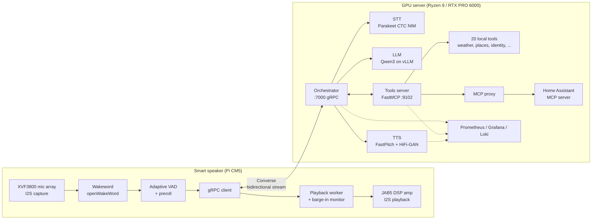

# ai-orchestrator

This is a fully local voice assistant. A custom smart speaker built on a Raspberry Pi CM5 talks to a GPU server over one bidirectional gRPC stream. Speech recognition, the language model, tool calling, and speech synthesis all run on hardware in the house. Nothing in the audio path touches a cloud API.

This repository is a sanitized snapshot of a personal project, published as a reference for how I design and build systems. It is not packaged for reuse; there is no one-command install. It does show a working end-to-end system with the tradeoffs left visible. It has streaming everywhere, barge-in, per-speaker identity, an MCP tool plane with authorization boundaries, and observability from the first commit.

I am Ian Bennett ([github.com/ianisms](https://github.com/ianisms)). The source is available for review under the PolyForm Strict License 1.0.0. Any other use needs my written permission. See [LICENSE.md](LICENSE.md) and [NOTICE](NOTICE).

## What is here

| Path | What it is |
|---|---|
| [`server/`](server/README.md) | GPU server: gRPC orchestrator, MCP tools server and proxy, custom TTS service, Docker Compose stack with Prometheus, Grafana, and Loki |
| [`speaker/`](speaker/README.md) | Pi CM5 voice client (wakeword, VAD, capture, playback, barge-in), device tree overlay, bring-up scripts, custom KiCad carrier board, 3D-printed enclosure |
| [`DESIGN_NOTES.md`](DESIGN_NOTES.md) | Design notes with file references |
| [`security/`](security/README.md) | Agent identity and authorization prototypes: token exchange delegation, revocation, a policy check before every tool call with the policy grammar in Rego, voice step-up rules, threat model |

Everything in `server/` is Python 3.11 with `asyncio`, gRPC, FastMCP, FastAPI, and NVIDIA NeMo. The speaker client is Python on Raspberry Pi OS in a Docker container with ALSA passthrough. Hardware sources are KiCad 9 and STEP.

## Architecture

One turn runs end to end like this. The speaker hears the wakeword, plays a chime, and streams 16 kHz PCM frames to the orchestrator. The orchestrator forwards audio to the STT service as it arrives and starts a speculative LLM call on partial transcripts. When the utterance commits, the LLM streams a reply. Any tool calls in it are validated locally, dispatched in parallel over MCP, and folded back into a second low-temperature synthesis pass. Reply text is sanitized for speech and streamed to the TTS service. The TTS service returns PCM that the orchestrator relays to the speaker in chunks. If the user talks over the reply, the speaker detects it, sends `Cancel`, and the server tears down TTS mid-stream.

## Things worth reading

These are the parts I would point a reviewer at first. [`DESIGN_NOTES.md`](DESIGN_NOTES.md) has the full list with file references.

**Audio never crosses the tool protocol.** Speaker identification needs the turn's audio, but base64-encoding seconds of PCM through JSON-RPC is the wrong shape. The orchestrator instead wraps the STT input queue in a duck-typed `AudioTapQueue`. It records frames in passing, writes a WAV on commit, and injects an opaque `[AUDIO_REF session_id audio_id]` into the prompt. The identity tool reads the file from a shared mount. There is zero copy on the hot path, and the reference is bound to this turn so it cannot be replayed. ([`server/modules/orchestrator/core/audio_tap.py`](server/modules/orchestrator/core/audio_tap.py))

**Authorization boundaries the model cannot cross.** Two kinds of state are scoped by values the LLM never supplies. `client_id` for per-device preferences comes from the gRPC peer, and person identity comes from the current turn's audio. The MCP proxy enforces per-upstream `allowed_tools` and `denied_tools`, and deny wins. It namespaces upstream tools as `server__tool` so nothing collides. It unregisters a server's tools when its liveness ping fails, so the model never sees a tool it cannot call. Tool arguments are validated against JSON Schema locally before dispatch. Unknown tool names are dropped and never called. ([`server/tools_server/mcp_proxy.py`](server/tools_server/mcp_proxy.py), [`server/modules/orchestrator/core/utterance.py`](server/modules/orchestrator/core/utterance.py))

**Agent identity prototypes, built next to the assistant.** `security/` holds standalone prototypes for the next layer of that boundary. RFC 8693 token exchange carries the whole agent chain (user > gateway > sub-agent) in an `act` claim. An AuthZEN-shaped policy check in OPA runs before every `tools/call` and fails closed. Voice step-up rules cover the speaker match threshold, home-network origin, liveness, and confirmation on by default and mandatory for high-risk tools. A threat model lists the attacks run against them. The delegation and policy prototypes still run on their own. The voice rules also run inside the orchestrator as a gate in front of every tool call, in monitor mode until the liveness check and approval channels exist ([`server/modules/orchestrator/core/voice_gate.py`](server/modules/orchestrator/core/voice_gate.py)). CI runs the security and voice gate tests on every pull request, and the check is required on `main`. ([`security/README.md`](security/README.md), [`security/THREAT_MODEL.md`](security/THREAT_MODEL.md))

**Hot reload propagated end to end.** Save a tool file on the server and the LLM's tool list updates without restarting anything. `watchfiles` triggers an unregister-then-reload in the tools server. The tools server pushes a `ToolListChangedNotification` to every live MCP transport. The orchestrator's client picks it up and refreshes asynchronously. ([`server/tools_server/loader.py`](server/tools_server/loader.py), [`server/modules/orchestrator/tools/mcp_client.py`](server/modules/orchestrator/tools/mcp_client.py))

**Upstream MCP schemas rewritten from YAML.** Home Assistant's MCP tool descriptions were written for a chat UI. A voice model has to pick `name`, `area` or `floor` in one shot and needs something tighter. `mcp-servers.yaml` overrides descriptions and entire parameter schemas per upstream tool without forking the upstream server, and stamps provenance into tool metadata. The proxy also carries a transport subclass because Home Assistant needs `POST` for its SSE stream. ([`server/tools_server/mcp-servers.yaml`](server/tools_server/mcp-servers.yaml), [`server/tools_server/mcp_proxy.py`](server/tools_server/mcp_proxy.py))

**Degrade before evict.** Under session pressure the orchestrator shrinks every session's history token budget instead of dropping conversations. It only hard-evicts LRU above a separate 1.25x cap. The budget itself is negotiated from the model's real `max_model_len` at startup. Config can lower it but never overflow the context. ([`server/modules/aiserver/server.py`](server/modules/aiserver/server.py))

**Barge-in on both ends.** Server side, any inbound audio frame while `SPEAKING` sets an `asyncio.Event` that doubles as the TTS cancel token. Client side, a dedicated VAD instance watches the mic only during playback. A stale-queue drain and a 600 ms chime-bleed guard keep it from triggering on its own output. The client also has a documented late-cancel path. The receive loop polls the cancel event because the transmit task has already exited after end-of-utterance. ([`speaker/modules/speaker/capture_streamer.py`](speaker/modules/speaker/capture_streamer.py), [`speaker/modules/speaker/grpc_client.py`](speaker/modules/speaker/grpc_client.py))

**Three queues, three overflow policies.** Inbound audio and text drop the oldest. The outbound queue evicts the oldest and records which message kind was dropped. On the speaker, the `control` event topic is unbounded while telemetry topics drop. Losing a wakeword or barge-in event is unacceptable. Losing a stats event is fine. ([`server/modules/aiserver/server.py`](server/modules/aiserver/server.py), [`speaker/modules/speaker/events_bus.py`](speaker/modules/speaker/events_bus.py))

**Prosody-aware TTS streaming.** The TTS service chunks on sentence boundaries and merges tiny trailing fragments backwards because they synthesize badly. It crossfades chunks with an equal-power window and inserts real silence at sentence ends. Text normalization runs under a 150 ms budget and falls back to raw text, so it is never a latency floor. A single GPU lock serializes synthesis because the LLM, STT, and TTS share one card. ([`server/tts/server/`](server/tts/server/))

**Proto drift shows up as a warning.** The server hashes its own `.proto` at startup and exchanges the SHA in gRPC metadata. Skew between the Pi and the server shows up as one log line instead of a deserialization bug three layers down. ([`server/modules/aiserver/server.py`](server/modules/aiserver/server.py))

## Hardware

The speaker is a Raspberry Pi CM5 on a custom carrier board ([`speaker/hardware/pcb/theboard/`](speaker/hardware/pcb/theboard/), KiCad, revision 3.7). An XMOS XVF3800 four-mic array captures over I2S and a Wondom JAB5 (ADAU1701 DSP) amplifier plays back over the same bus. The Pi is bitclock and frame master for both. A single device tree overlay ([`speaker/overlays/xvf3800-jab5-i2s.dts`](speaker/overlays/xvf3800-jab5-i2s.dts)) exposes them as one ALSA card with capture and playback. Power is an internal Mean Well 28 V supply with a captive AC cord. The enclosure ([`speaker/enclosure/`](speaker/enclosure/guide/guide.md)) is 3D printed with a wood veneer wrap. STEP solids and the build guide are included.

[`speaker/README.md`](speaker/README.md) has the wiring table, power architecture, and bring-up sequence.

## Running it

This is not turnkey, but the pieces are all here. The server expects an NVIDIA GPU with enough VRAM for the three inference services, Docker with the NVIDIA container toolkit, and model weights under `/ai/server/` as described in [`server/README.md`](server/README.md). Copy `server/.env.example` to `.env` and fill in the API keys for whichever tools you enable. `docker compose up` in `server/docker/` brings up the stack with health-gated dependency ordering.

The speaker client is built and deployed with `speaker/scripts/build_pi_release.sh` and `deploy_pi_release_wsl.sh`. See [`speaker/README.md`](speaker/README.md).

## What was removed for publication

Secrets were never committed. These were stripped or generalized:

- LAN addresses and hostnames
- personal contact details and example locations
- the local model directory name
- the system prompt persona
- AI coding-assistant session files
- an earlier generation of the speaker client
- PCB revisions 3.5 and 3.6 and the fabrication order files
- large generated artifacts (STEP exports of the PCB, footprint caches)

The custom TTS voice model, the custom wakeword model, and their training data are not included; the wakeword config defaults to a public openWakeWord model. Git history was not carried over.

## Author

Ian Bennett is a principal engineer and architect with 27 years in software, most recently at Microsoft on Azure Identity Governance and Azure Customer Lockbox. This project is where the identity and authorization thinking from that work meets a soldering iron.

## Decisions and division of labor

This repo was built the way I build now. I set the design and the rules. Claude (Claude Code and the Claude app) wrote most of the implementation, tests and docs against those designs. I reviewed, pushed back, and merged. The design calls below are mine. Where an agent proposed something I rejected or changed, the final shape is what is in the tree.

- The model never supplies its own identity. Speaker identity comes from the turn's audio. Origin comes from the device credential the speaker proved with its hardware key, or from the gRPC peer until that is required. Neither ever comes from headers or from anything the model says. Saying "I'm Alice" queues an enrollment sample for out-of-band approval and never changes a profile. New voices are enrolled in an admin-run session with prompted sentences and a separation check against the other voices in the house ([`security/VOICE_ENROLLMENT.md`](security/VOICE_ENROLLMENT.md)).
- The voice gate takes a strong speaker match, device origin and a liveness check as policy inputs. Confirmation is on by default and never waivable for high-risk tools. Unknown tools are treated as writes. Any missing signal denies. It rolled out in monitor mode first, with enforce after calibration, the same way I onboarded services to Customer Lockbox.
- Agents pass delegation, never credentials. Every hop exchanges for its own tokens with its own identity. Scope only narrows down the chain, depth is capped, and tools reject tokens without the `act` chain.
- Revocation cuts the narrowest thing first: a token, then a grant, then a client. The user token's `grant_id` travels unchanged down the chain, so revoking it kills the whole family. That closes a gap Keycloak leaves open. Tool servers can report a token with a reason, and the STS decides whether a report escalates.
- No stored secrets where federation can replace them. A tool that cannot speak OAuth sits behind a proxy that can. The proxy fetches the native credential per call and holds nothing at rest. Every remaining static secret carries a migration date.
- One broker surface for agents, with adapters underneath that use each platform's workload identity where it exists and our own where it does not. Agents never carry per-platform code.
- Device identity for the speaker is a plugged-in YubiKey now, because it ships this month, and then a TPM 2.0 on the PCB of the next carrier-board revision. I design the board, and a part on the board beats a dongle.
- The enclosure design is entirely mine. The CM5 carrier board was a joint effort. I authored the KiCad files, schematic and layout, and Claude advised on component selection.
- Publication is a sanitized single-commit copy of the private repos, with the MAUI client left out and PolyForm Strict in place of MIT so the code is usable only with my consent.

Claims were checked against the tree in both directions. When my description outran the code (the voice gate rules, before the gate existed), the gap became a backlog item and then the prototype. When a doc outran the code (an attestation story that called network origin plus voice "attestation"), the doc was cut back to what is true.

Three things are still unproven. The YubiKey signer has not run on hardware. The device credential is not yet enforced on the gRPC stream. The voice gate is in monitor mode. I would sooner say that here than have you find it.
