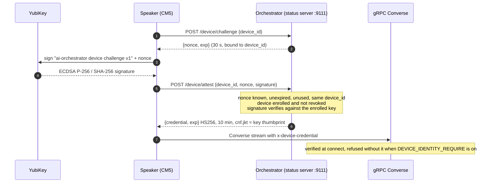
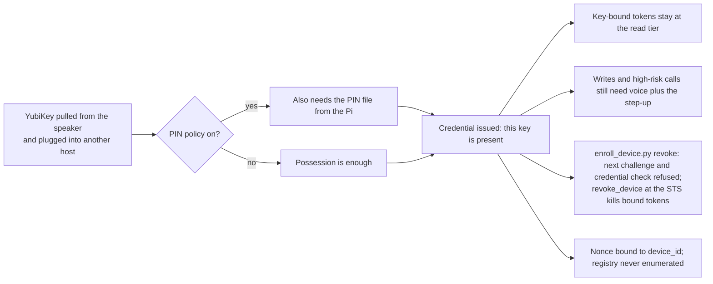
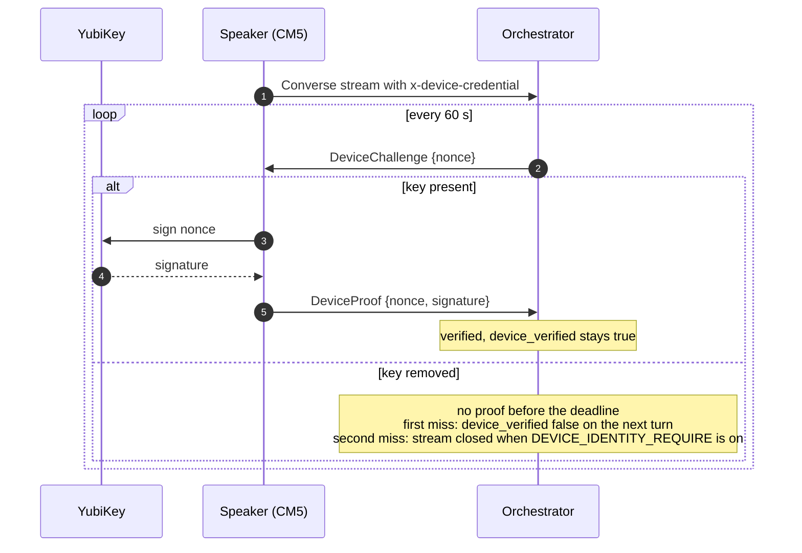
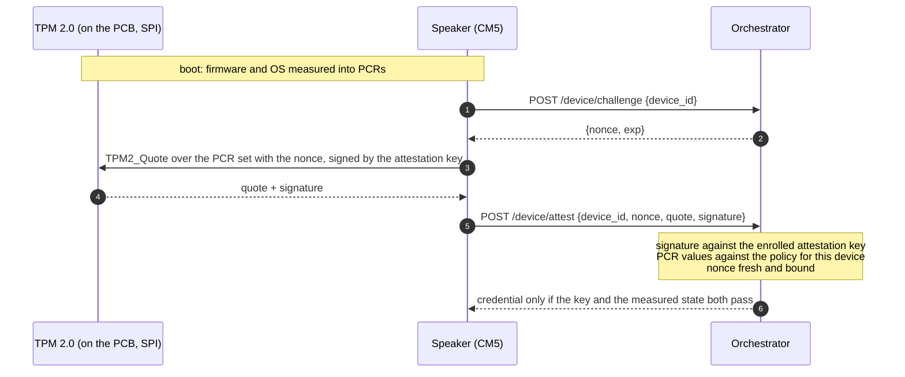

# Device identity for the speaker

The orchestrator has to know which speaker is on the other end of a gRPC
stream. Any host on the network can open one. This doc covers how a
speaker proves which device it is. `SESSION_BINDING.md` covers what the session
does with that identity.

## Current state

At boot the speaker signs a challenge with a key that never leaves the YubiKey.
The orchestrator answers with a short-lived credential, and the speaker sends
that credential on every stream it opens. With `VOICE_GATE_REQUIRE_DEVICE` on,
the credential is the gate's origin signal. With it off, the gate checks the
gRPC peer address against `VOICE_GATE_TRUSTED_SPEAKER_NETS`, and any host on a
trusted address passes (threat 18). Who is speaking is a separate question,
answered from each turn's audio.

A YubiKey 5 plugged into the CM5 holds the key. The key is generated on the
YubiKey and cannot be exported. The exchange at boot looks like this.

Files:

| Control | Where | Status |
|---|---|---|
| Signer interface, `YubiKeyPivSigner`, `FakeSigner` | `speaker/modules/speaker/device_identity.py` | built; YubiKey path reviewed against the yubikit API, not exercised in CI |
| Boot-time attest client, credential cache | same file, `DeviceAttestClient`; called from `orchestrator.py` `_attest_device` | built, off by default (`device_identity_enable`) |
| Enrollment: generate key on the YubiKey, export public key, write request | `speaker/scripts/enroll_device_key.py` | built |
| Registry (JSON, `device_id`, `room`, `household`, public key PEM, thumbprint, `enrolled_at`, `revoked_at`) | `server/modules/orchestrator/core/device_identity.py`, file at `DEVICE_REGISTRY_PATH` | built |
| Admin: add, list, revoke, remove | `server/scripts/enroll_device.py` | built |
| Challenge, verify, credential mint and verify | `DeviceIdentityService`, routes on the status server | built |
| Credential read from gRPC metadata at connect | `server/modules/aiserver/server.py`, `device_from_metadata` | built: verified and logged; refused with UNAUTHENTICATED when `DEVICE_IDENTITY_REQUIRE` is on (off by default) |
| Speaker attaches the credential to the Converse stream | `DeviceAttestClient.grpc_metadata()` via `OrchestratorGrpcConfig.metadata_provider` | built: sent at every connect, re-attested when stale |
| Voice gate reads the device credential | `core/voice_gate.py`, `origin_trusted`; `core/utterance.py`, `set_device` | built: origin signal when `VOICE_GATE_REQUIRE_DEVICE` is on (off by default); `device_verified` bounds on the credential's expiry per turn |
| User token bound to the device key | `security/delegation/sts.py`, `issue_user_token(device_jkt=...)` | built (prototype): `SESSION_BINDING.md` |

Signing does not require a touch, because nobody is there to touch it. The
YubiKey asks for its PIN once at boot. The client reads the PIN from a file only its
own user can read. The management key is used at enrollment and is not kept
on the device. In a sealed enclosure the PIN can be turned off too; possession
of the key is then the whole secret.

Everything fails closed. No key, unknown device, revoked device, unknown
nonce, expired nonce, replayed nonce, nonce issued to another device, and bad
signature all deny with a logged reason (`device_identity.audit`). A failed
attempt consumes the nonce, so there is no second guess. The credential dies
on expiry, on a registry revocation, and on an orchestrator restart, because
the HMAC key is per process.

The tests are `server/test/test_device_identity.py`, which runs both sides
through the HTTP glue in process with `FakeSigner`, and
`speaker/test/test_device_identity.py`. CI runs both without hardware.

This proves that the device holds the enrolled key. It does not prove what
software is running on it. There is no measured boot, no PCR quote and no
attestation key chained to a manufacturer. A CM5 whose root filesystem has been
replaced still attests fine if the YubiKey is plugged in. This is device
identity. Attestation is the future state below.

### Theft of a pluggable key

A YubiKey can be pulled from the speaker and plugged into a laptop. With the
PIN policy on, the attacker also needs the PIN file from the Pi. Without it,
possession is enough. Either way, the credential means "this key is present".
It does not mean "this is the trustworthy kitchen speaker". Four mitigations
apply, in this order.

1. Key-bound tokens are limited to low-risk scopes. The device credential
   carries `cnf.jkt`. A user token bound to it (`SESSION_BINDING.md`) carries
   the gate's assurance record, and policy keeps a device-only signal at the
   read tier. Writes still need the voice match plus confirmation.
2. High-risk actions still need voice plus a challenge. A credential never
   replaces the speaker match, the liveness check or the phone approval for
   writes and high-risk calls. The last two are not built.
3. Enrollment is revocable in one step (`enroll_device.py revoke`). Revocation
   stops every future challenge and every credential check for that key the
   moment the registry file is written. Until then the speaker that lost the
   key stays trusted for the rest of its credential, 10 minutes by default and
   15 at the cap. The 60 s re-challenge under "Future state" shrinks that to a
   minute.
4. The nonce is bound to the `device_id` that asked for it, and the challenge
   route never enumerates the registry. A stolen key cannot be probed for
   which device it belongs to.

## Future state

### Re-challenge on the open stream

The credential lasts ten minutes. Pull the YubiKey in minute one and the
stream stays trusted until minute ten. A speaker without its key cannot answer
a challenge, so the fix is to ask more often.

The orchestrator sends a fresh nonce on the open stream every 60 seconds. The
speaker signs it or it does not. A missed answer sets `device_verified` false
on the next turn. A second miss closes the stream when `DEVICE_IDENTITY_REQUIRE`
is on. No new credential is minted. The credential becomes a record that this
speaker answered recently, and the interval is the control.

Trust never depends on the speaker reporting its own state. The speaker can
also watch for card removal through pcscd and reconnect sooner, but that is
for logging and recovery, not for trust. The cost is one signature a minute,
well inside what the YubiKey can do.

### TPM on the carrier board

The next carrier-board revision (`speaker/hardware/pcb/theboard/`, rev 3.7
today) puts a TPM 2.0 on the PCB over SPI. The key is generated in the TPM and
never leaves it, and nothing is pluggable. The TPM's PCRs let the orchestrator
require a quote over the boot chain before issuing the credential. The device
then proves what software it runs as well as which key it holds.

The orchestrator side keeps its shape. There is still a signer behind the
`Signer` interface, an enrollment registry keyed by thumbprint, a short nonce
and a short-lived key-bound credential. The TPM adds a quote to the attest
request and a PCR policy to the verifier. The re-challenge above works the same
way with a TPM key. The session pieces in `SESSION_BINDING.md`
do not change; moving the key from the YubiKey into the TPM changes the signer
and nothing else.
