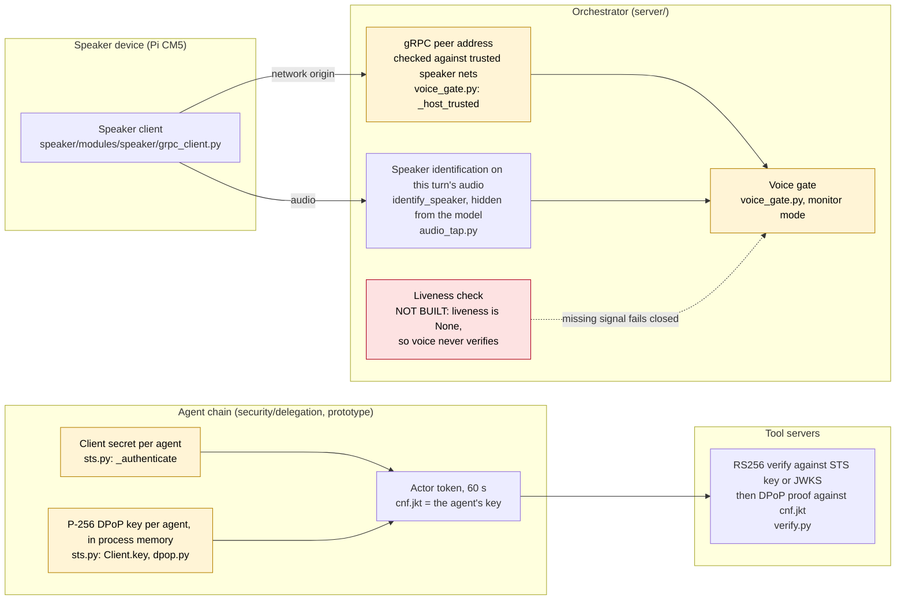
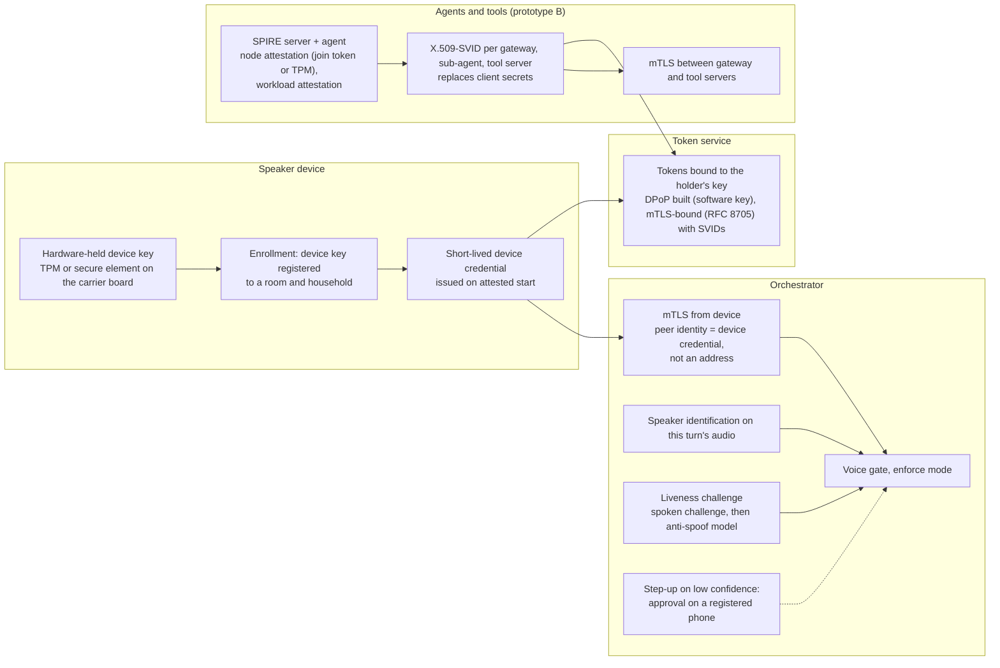
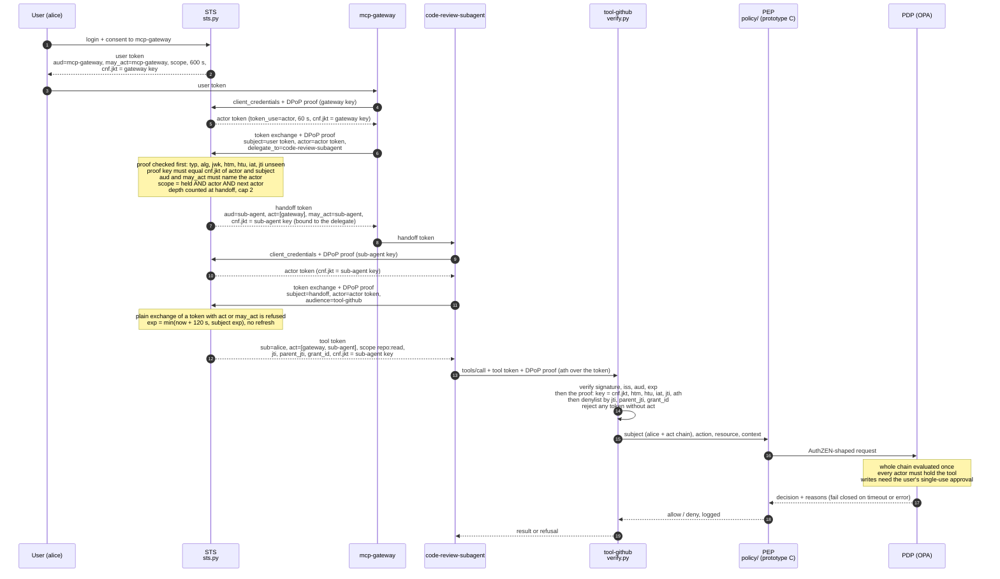
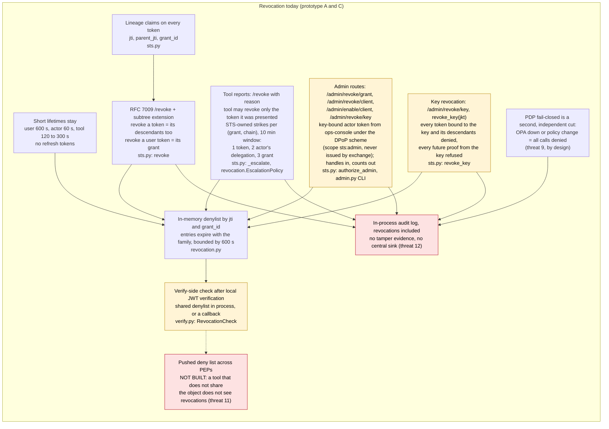
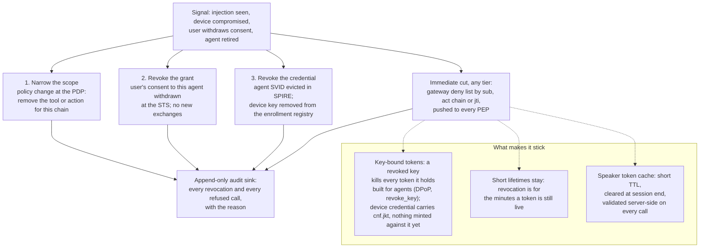

# Diagrams: attestation, token exchange, revocation

Current state is what runs in this repository today. Target state is the design the
prototypes are heading toward. Every "today" box names the file that implements it;
every gap names the threat in `THREAT_MODEL.md` it leaves open.

Status key: built = runs with tests; partial = runs but with a documented gap;
not built = design only.

## 1. Attestation today

Three kinds of principal reach the tool plane: the speaker device, the person
speaking, and the agents that act for them. Today each is trusted on a different
basis, and none of it is hardware-backed.

What this means, in one line each:

- The device is trusted by where it is, not what it is. A trusted address is a
  network-origin check (`trusted_speaker_nets`), so a compromised host on that
  address passes (threat 18).
- The person is trusted by voice match plus origin. Liveness is not built, so in
  enforce mode no voice would verify; that is why the gate ships in monitor mode
  (threats 15, 21).
- Agents are trusted by a client secret plus a DPoP key. The secret alone mints
  nothing: the proof must come from the registered key (threat 6). The key is a
  Python object in the agent's process, so it proves "this process" and not
  "this attested workload". Workload identity is prototype B, not built
  (threat 13).
- Tokens are sender-constrained (RFC 9449). Every token carries `cnf.jkt` and
  every call carries a proof from that key, so a stolen tool token is refused
  without it (threat 1). What that does not cover is a compromised process,
  which holds the key.

## 2. Attestation target

The device proves what it is with a key it cannot export; the agent proves what it
is with a workload identity issued from attestation; the person still authenticates
through the identity provider, with voice as a signal on top; and every token is
bound to the key of the thing that holds it.

What changes:

- "Where" becomes "what": the gRPC peer check becomes an mTLS peer identity from a
  key held in hardware. Closes threat 18 as a spoofing problem; a compromised device
  is then a revocation problem (section 4).
- The voice gate gets its missing signal. Liveness lands, then enforce mode (threats
  15, 21, rollout steps 1 to 4 in `THREAT_MODEL.md`).
- Agents get SVIDs instead of secrets. The actor credential at the STS becomes the
  SVID, and the policy decision gets the SPIFFE ID as the workload attribute
  (threats 6, 13).
- Tokens are sender-constrained today by DPoP to a key in the agent's process;
  with SVIDs the same binding moves to the mTLS connection (RFC 8705) and the
  key out of process memory (threat 1; "next controls" item 1, partial).

The one-line version: today the speaker is trusted by network origin plus voice;
the target is a hardware-held device key, so the speaker proves what it is, not
just where it is.

## 3. Token exchange, as built (prototype A)

Runs in `security/delegation/`, 71 tests. The chain is user > mcp-gateway >
code-review-subagent, access narrows at every hop, and every token is bound to
the key of the client that presents it (cnf.jkt), proved on each call by a
DPoP header.

Rules the STS enforces on every exchange (each denial is logged with its reason):
a DPoP proof from the key the actor token and the subject token are bound to;
delegation requires an actor token owned by the authenticated client; the subject's
`aud` and `may_act` must both name the actor; scope only narrows; audience and
`delegate_to` must be registered; chain depth is capped at 2; no refresh tokens.

Attacks run and refused: expired replay, exchange without `may_act`, another agent
presenting the user's token, sub-agent asking for `repo:write`, unregistered tool,
act-chain stripping, borrowed actor token, handoff token sent to a tool, stolen
tool token without a proof, with another key, with its captured proof replayed,
with a proof for another URI, with a stale proof, exchange without a proof or
under another client's key, revoked key.

## 4. Revocation today and target

### Today

Today the answer to "how do you revoke" is: call `/revoke` with the user token and
every token exchanged from it is refused at the STS and at any tool that shares the
denylist, within the same process. A tool server that sees something wrong reports
the token it was given and the STS, not the tool, decides how far that goes: one
report kills the token, two the actor's delegation, three the grant, inside a ten
minute window. An operator revokes a grant, retires an agent or revokes a key by handle
through the admin routes, with the ops-console's own key-bound actor token as the
credential. Tokens are bound to keys (DPoP), so a revoked key kills every token
it holds, within the same process. Across processes the answer is still "wait up
to five minutes, or pull the policy." Still missing: the pushed deny list to every
PEP, SVID revocation for agents and an admin SVID for the console (prototype B),
and the central audit sink. The first hop at Keycloak does not
participate: Keycloak's `/revoke` knows only its own tokens, and the STS neither
introspects the subject on exchange nor consumes Keycloak admin events.

### Target

Revoke the narrowest thing that stops the harm, and make the cut immediate.

Order of operations, narrowest first: scope, then grant, then credential. A gateway
deny-list entry is the immediate cut at any tier while the slower revocation lands.
Every hop is audited (threats 11, 12; "next controls" items 1, 2, 5). The key-bound
box is true for agents today: `revoke_key` in `sts.py` denylists everything bound
to a thumbprint and refuses its proofs. It is not yet true for the speaker, whose
device credential carries `cnf.jkt` but has nothing minted against it.

## Where each piece lives

| Piece | Status | Where | Threats |
|---|---|---|---|
| Network-origin check for the speaker | built | `server/modules/orchestrator/core/voice_gate.py` | 18 |
| Speaker identification on the turn's audio | built | `server/modules/orchestrator/core/audio_tap.py`, identity tool | 16 |
| Liveness check | not built | rollout step 3 | 15, 21 |
| Spoken confirmation and phone approval | not built | rollout step 2 | 17, 19 |
| Hardware device key, enrollment registry, mTLS from device | not built | section 2 | 18 |
| Client-secret actor credentials | built (prototype) | `security/delegation/sts.py` | 6 |
| SPIFFE/SPIRE workload identity | not built (prototype B) | section 2 | 6, 13 |
| RFC 8693 exchange with nested `act` chain | built | `security/delegation/sts.py` | 2, 3, 4, 5 |
| Tool-side verifier | built | `security/delegation/verify.py` | 5, 10 |
| AuthZEN-shaped PEP and OPA PDP, fail closed | built | `security/policy/` | 7, 8, 9 |
| Sender-constrained tokens (DPoP, RFC 9449) | built (prototype, partial): software key in process, no nonces, no rotation; mTLS-bound waits for SVIDs | `security/delegation/dpop.py`, `sts.py`, `verify.py` | 1, 6 |
| Lineage claims, RFC 7009 `/revoke` with subtree extension, in-memory denylist, verify-side check | built (prototype) | `security/delegation/sts.py`, `revocation.py`, `verify.py` | 11 |
| Tool reports with STS-owned escalation (token, delegation, grant) | built (prototype) | `security/delegation/sts.py: _escalate`, `revocation.EscalationPolicy` | 11, 7 |
| Admin revocation routes behind an `sts:admin` actor token | built (prototype) | `security/delegation/sts.py: authorize_admin`, `admin.py` | 11 |
| Revocation beyond lifetimes | partial | section 4; key revocation built (`sts.py: revoke_key`); pushed deny list across PEPs, SVID revocation and an admin SVID not built | 11 |
| Append-only audit sink | not built | next controls item 5 | 12 |
