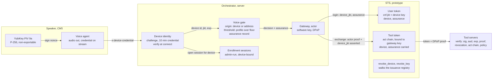
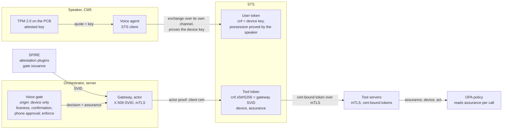
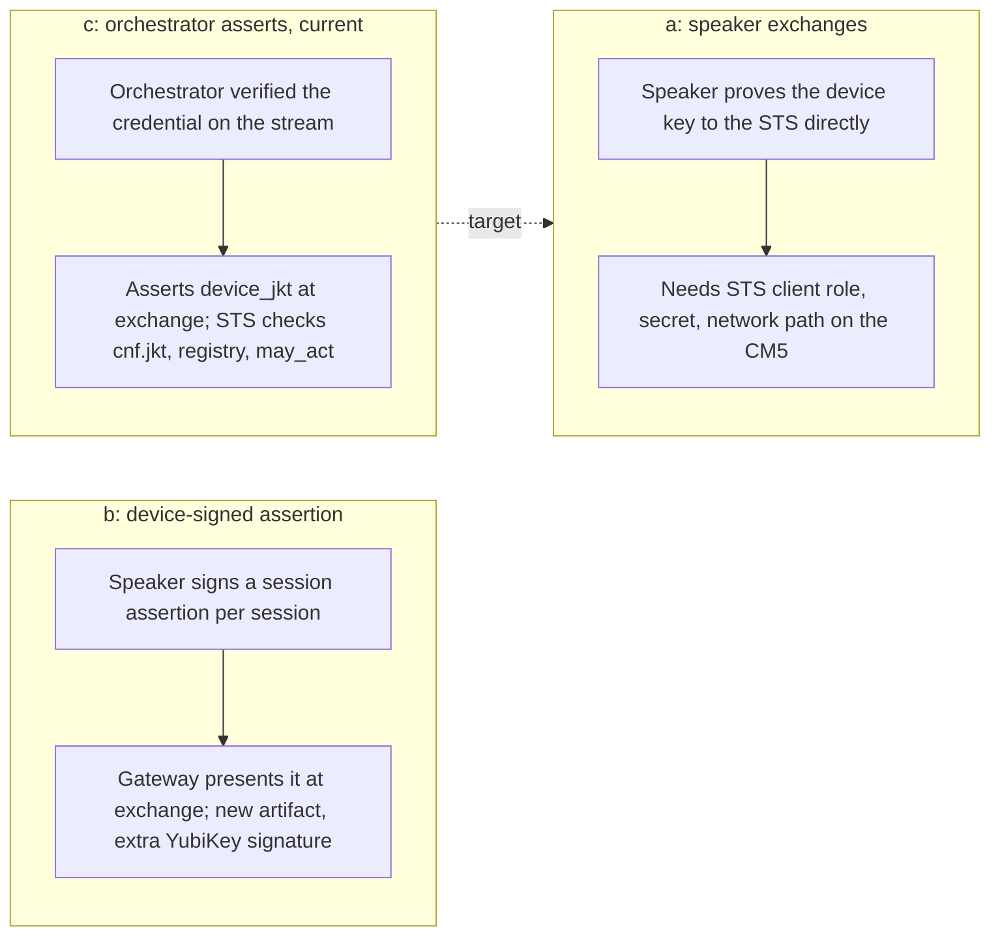
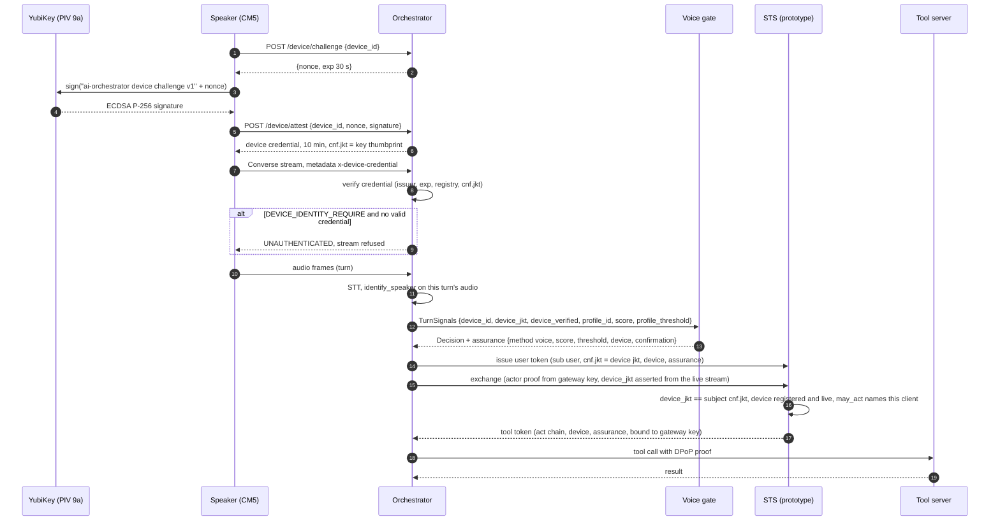
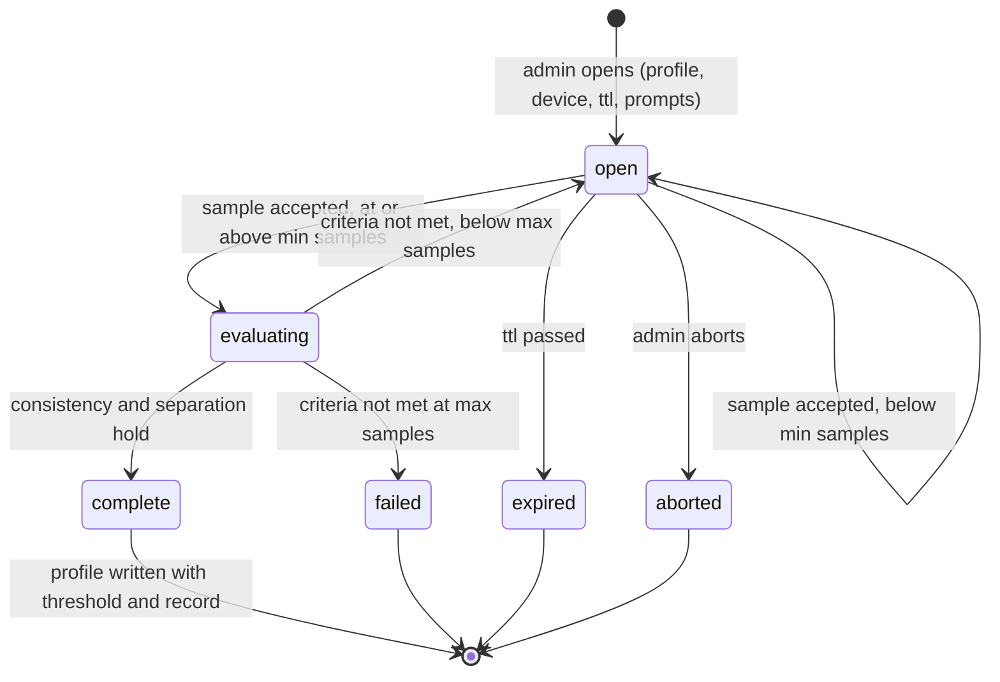
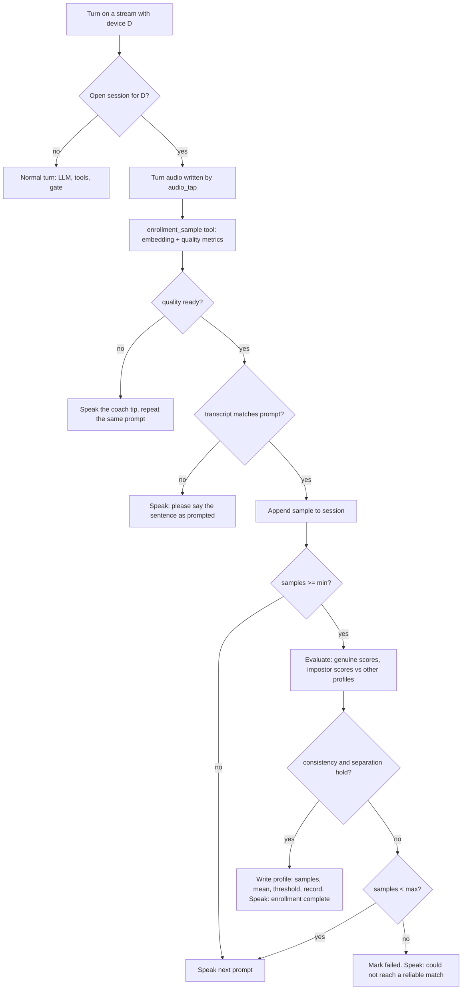
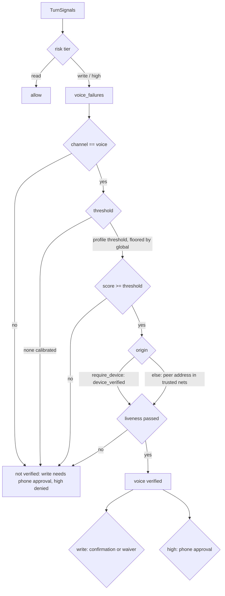

# Device-bound sessions and admin-run voice enrollment

This page covers how a speaker's session is bound to its hardware key and how
voices are enrolled, as of v2.0 and as planned, with the reasoning behind the
choices. `DEVICE_IDENTITY.md` describes the key and the challenge,
`VOICE_ENROLLMENT.md` the enrollment procedure, and `THREAT_MODEL.md` the
threats each control answers.

The design holds three properties. The speaker is trusted because of a key it
holds, rather than because of its network address or the voice on the stream;
a device credential that is verified at connect but never carried on the
stream, read by the voice gate or bound into a token would leave the gate
deciding on a gRPC peer address, which any host on a trusted address passes
(threat 18). The user token is bound to a key that cannot leave the device; a
token bound to a software key in the process that presents it
(`delegation/dpop.py`) protects against a copied token but not against an
attacker inside that process, and the user token is the only leg of the chain
that can be tied to the speaker's hardware key. A voice match is backed by a
measured enrollment; a single uncalibrated threshold, with samples approved one
at a time without quality, separation or a record of who approved them, gives
a weaker signal than it appears to.

Status key, same as elsewhere in `security/`: built = runs with tests; partial =
runs but with a documented gap; not built = design only.

## Current state

What runs as of v2.0, what each piece binds, and which switches are off.

| Piece | Where | Status |
|---|---|---|
| Speaker holds a P-256 key in YubiKey PIV 9a; signs a 30 s nonce at boot; gets a 10 min credential with `cnf.jkt` | `speaker/.../device_identity.py`, `server/.../device_identity.py` | built, off by default (`device_identity_enable`) |
| Credential rides on every Converse call as `x-device-credential`, re-attested when stale | `grpc_client.py` metadata provider, `capture_streamer.py` | built |
| Orchestrator verifies the credential at connect; refuses the stream without one when `DEVICE_IDENTITY_REQUIRE` | `aiserver/server.py` | built, switch off |
| Voice gate takes the device as origin when `VOICE_GATE_REQUIRE_DEVICE`; `device_verified` bounded by credential expiry per turn | `core/voice_gate.py`, `core/utterance.py` | built, switch off (address check until then) |
| Per-user threshold from enrollment, floored by `VOICE_GATE_MIN_SCORE` | `voice_gate.effective_threshold`, `identify_speaker` | built; floor still uncalibrated |
| Assurance record on every gate decision and audit line | `voice_gate.assurance` | built; not yet an OPA input |
| Admin-run enrollment session: device-bound, time-boxed, prompted; quality, prompt match, consistency, separation; profile with threshold and record; revocation | `core/voice_enrollment.py`, `scripts/enroll_voice.py`, `enrollment_sample` | built |
| STS: root user token bound to the device key; consented client asserts the thumbprint it verified on the stream; `device` and `assurance` down the chain; `revoke_device` kills the subtree | `delegation/sts.py`, `verify.py`, `admin.py` | built (prototype, `security/` only) |
| Actor leg (gateway, sub-agents, tool tokens): bound to software P-256 keys in process (DPoP) | `delegation/dpop.py`, `sts.py` | built; stops copying, not process compromise |
| Liveness, spoken confirmation, phone approval | | not built; gate in monitor mode because of it |

Dashed boxes are built but their enforcement switch is off until every speaker
attests. The orchestrator was already the component that asserts who is
speaking; in this picture it also asserts which device the stream came from.
No new component is trusted.

## Future state

The same structure, with the keys moved into hardware and the orchestrator's
assertions replaced by proofs wherever a proof is possible.

| Step | What moves | Why |
|---|---|---|
| Speaker as STS client (option (a) under "Who proves possession at the exchange") | The speaker performs the exchange itself over its own channel; the STS checks possession of the device key directly | Removes the orchestrator's assertion of the device; the one place today where a compromised orchestrator could lie |
| TPM 2.0 on the carrier board (`DEVICE_IDENTITY.md`) | The key is generated in the TPM and stays there; no pluggable part; a quote over the boot chain before the credential is issued | Device identity becomes attestation, covering which software runs as well as which key is present |
| Prototype B: SPIFFE/SPIRE for the actor leg | Gateway and sub-agents get X.509-SVIDs from SPIRE with attestation plugins gating issuance; tokens bound with `cnf.x5t#S256` (RFC 8705) over mTLS, per connection; the DPoP software key retires | Closes the "key next to the token" gap on the actor leg; no per-request signing |
| Liveness, spoken confirmation, phone approval | The step-ups the gate already asks for exist; gate moves from monitor to enforce | A recording or a clone stops at the step-up instead of being logged |
| Assurance as an OPA input | Policy reads method, score, threshold source, device and confirmation state per call | Risk tier decided on what was measured, not on a flag |
| Enrollment from the phone | Open, approve and close sessions from the person's own device | The admin step leaves the host shell; the record is unchanged |

Four things stay the same in both pictures. The user token is the leg bound
to hardware. The `device` and `assurance` claims are copied unchanged down the
chain. Revocation walks the issuance registry. The gate never authorizes a
write or a high-risk call on a voice match alone.

## Reasoning

### Bind per connection, not per request

The simplest way to bind the agent to the YubiKey would be to have the agent
sign DPoP proofs with the PIV key. That does not work for two reasons. The
agent process runs on the server and the key is on the CM5. A PIV or TPM key
also signs roughly ten times a second, so signing a proof for every tool call
would cap throughput well below normal use.

The challenge flow in `DEVICE_IDENTITY.md` already proves possession once,
when the credential is minted. The speaker signs a nonce with the key that
cannot leave the YubiKey and receives a ten minute credential whose `cnf.jkt`
is the key's RFC 7638 thumbprint. Sending that credential on the stream binds
the stream to the key for the credential's lifetime, at the cost of one
signature every ten minutes. mTLS with a device certificate would bind the
same way, and the target diagram in `DIAGRAMS.md` draws it that way. It is not
used here because the YubiKey's private key cannot be reached from Python's
gRPC TLS stack without a PKCS#11 shim, and the credential provides the same
guarantee.

### Which leg of the chain gets the hardware key

The user token, which states that user X is present at device Y as confirmed
by the voice gate. It is the token an attacker on the server would most want
to replay, and the device's presence is the one claim the hardware key can
vouch for. The actor leg (gateway, sub-agents, tool tokens) stays bound to the
software keys of the processes that present those tokens, with `act` lineage
back to the device-bound user token. Moving those keys into hardware is
prototype B (SPIFFE), described under future state.

### Who proves possession at the exchange

RFC 8693 expects the party presenting a subject token to prove possession of
the key it is bound to. The gateway cannot sign with the speaker's key. Three
options were considered.

- (a) The speaker performs the exchange itself as the delegating client. This
  is the cleanest option, but it requires the CM5 to have an STS client role,
  a client secret and a network path to the STS, none of which it has today.
- (b) The gateway performs the exchange and presents a fresh session assertion
  signed by the device. This costs another YubiKey signature per session and
  requires defining a new artifact.
- (c) The orchestrator, which terminates the stream and already asserts the
  voice identity, asserts the device thumbprint it verified on that stream.
  The STS checks that the thumbprint equals the subject token's `cnf.jkt`,
  that the device is registered and not revoked, and that the exchanging
  client is the one the user consented to.

v2.0 uses (c). The orchestrator is already trusted to assert who is speaking,
so trusting it to also assert which device is on the stream does not add a new
trusted component. The cost is that a compromised orchestrator could assert a
device it did not see, in the same way it could already misreport the voice
identity. Every record carries the thumbprint, so such a misreport can be
traced to a specific stream. Option (a) is the target once the speaker is an
STS client.

### Stateless where possible

The device credential is stateless on the orchestrator side. The orchestrator
holds one HMAC key per process and persists nothing. The STS device registry is a map from thumbprint
to device id, loaded from the same JSON file the orchestrator's enrollment
registry writes, so a revocation is a single file write. No grant store was
added; a device revocation walks the issuance registry that the DPoP work
already maintains.

### The assurance record

The device binding is rooted in hardware and either holds or does not. Voice
identification is a cosine similarity against an enrolled mean and is
probabilistic. The `assurance` record keeps the two apart. It carries the
method (`voice`), the score, the threshold that applied and whether it came
from the user's profile or the global floor, the device id and thumbprint, and
whether a confirmation happened. Policy reads it by risk tier: a read can run
on a voice match alone, a write needs the confirmation, and a high-risk call
needs the phone approval. The record never claims more than the gate measured.
Today it lives in the gate decision and the audit line and the STS carries it
as a claim; the OPA input does not read it yet.

### Enrollment criteria

Enrollment is identity proofing, so it is measured. A session completes only
when four criteria hold.

1. Clip quality. Duration, clipping, level, signal to noise ratio and silence
   ratio, using the same checks as the enrollment coach.
2. Prompt match. The transcript of each clip must overlap the sentence that
   was prompted. Prompts are chosen per session, so a replayed recording of
   something else fails this check.
3. Consistency. Each sample's similarity to the mean of the other samples
   (the genuine score) must be at or above the threshold.
4. Separation. Each sample's similarity to every other enrolled profile's mean
   (the impostor score) must be below the threshold by a margin. The user's
   threshold is set from this measurement as the highest impostor score plus
   the margin, and never below the global floor.

An admin opens the session on the host. It is bound to one device and to a
time window, and the record names who opened it, for whom, on which device,
how many samples were taken and what scores resulted. Only embeddings are
stored; the audio clips follow the existing five minute cleanup.

Enrollment does not defend against a cloned voice. Prompted sentences defeat a
recording but not synthesis, so voice remains an identification signal and is
never the sole authorizer of a write or a high-risk call.

## Flows

### Device-bound session

Revocation: `enroll_device.py revoke <device_id>` writes the registry; the
orchestrator refuses the next credential check and the STS refuses the next
exchange; `revoke_key(<device jkt>)` at the STS kills every live token bound to
the device and their descendants.

### Enrollment session, states

### Enrollment sample, one turn

### Voice gate decision with the new signals

## Failure modes

Every new path fails closed.

| Condition | Behaviour |
|---|---|
| `DEVICE_IDENTITY_REQUIRE` on, credential missing, expired, forged, for a revoked device | Stream refused with UNAUTHENTICATED and a logged reason; the speaker re-attests and reconnects |
| `VOICE_GATE_REQUIRE_DEVICE` on, no verified device on the turn | Voice not verified: writes need phone approval, high-risk calls denied |
| Credential expires mid-stream | `device_verified` is false on later turns until the speaker reconnects with a fresh credential |
| Enrollment sample from a stream whose device is not the session's device | Rejected and logged; the session is untouched |
| Enrollment session open and the orchestrator has no device identity for the stream | Normal turns; enrollment never engages (unless `VOICE_ENROLLMENT_ALLOW_UNBOUND_DEVICE`, a development switch, is set) |
| STS exchange of a device-bound subject with a missing, different or revoked device thumbprint | `invalid_grant`, logged with the thumbprint |
| Device key revoked at the STS | Every token bound to it and every descendant denylisted; future assertions of that thumbprint refused |

## Limits

- The device binding covers the subject leg. The actor leg still depends on
  the orchestrator and gateway processes, which hold software keys. SPIFFE
  with attested SVIDs (prototype B) is the next step for that.
- The orchestrator asserts the device thumbprint at the STS. A compromised
  orchestrator could assert a device it did not see. This is the same degree
  of trust the system already places in it for the voice identity; the
  thumbprint on every record makes such a misreport traceable, not
  impossible.
- The YubiKey provides device identity, not attestation. It proves which key
  is present, not what software is running. `DEVICE_IDENTITY.md` covers the
  gap and the planned TPM on the carrier board.
- Voice identification is probabilistic and does not resist a cloned voice.
  The assurance record exists so that downstream policy always sees that.
- Enrollment quality depends on the prompts and the room. The coach checks
  catch a poorly placed microphone; they cannot compensate for a noisy
  kitchen.

## Threats answered

- 18 (origin spoofing): with `VOICE_GATE_REQUIRE_DEVICE` on, the gate decides
  on the device credential rather than the address.
- 17 (identity takeover by stated name): the pending-sample path is unchanged,
  and new voices go through the admin-run session with its criteria and
  record.
- 1 (token replay), for the user token: it is bound to a key that cannot leave
  the device rather than to a software DPoP key.
- 15 (voice spoofing): prompted sentences defeat a recording at enrollment.
  Cloned voices remain a residual risk and are listed as a limit.
