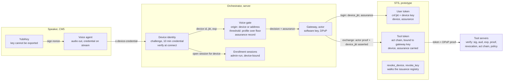
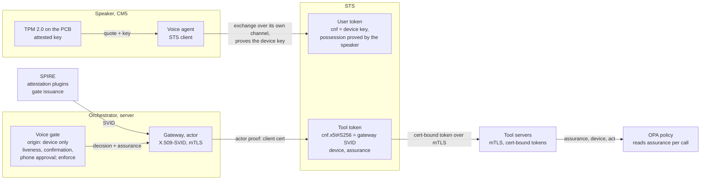
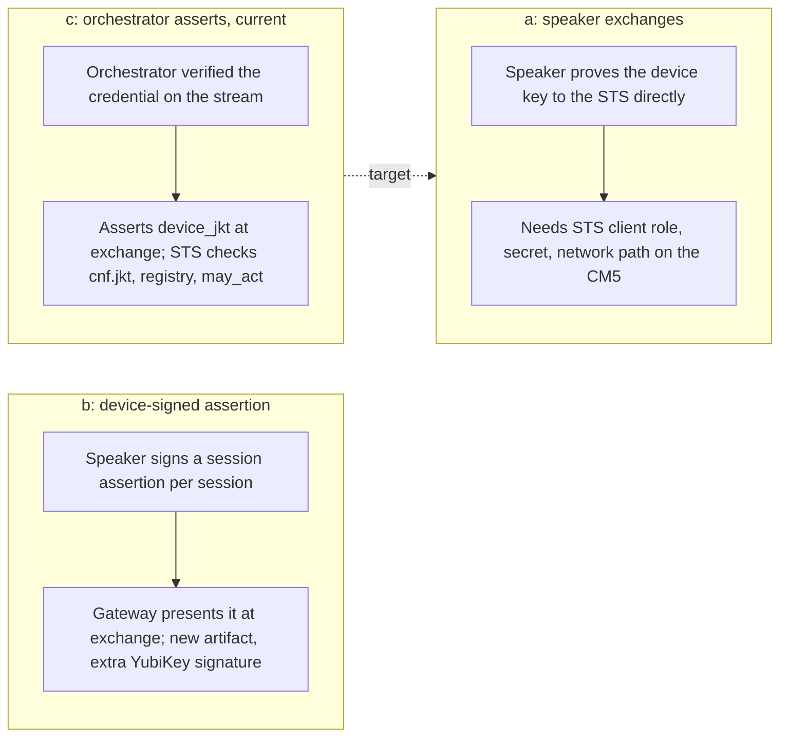
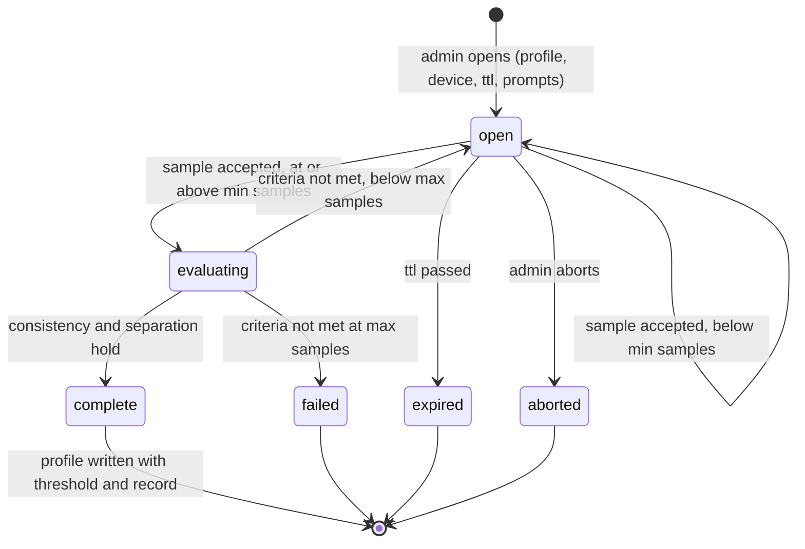
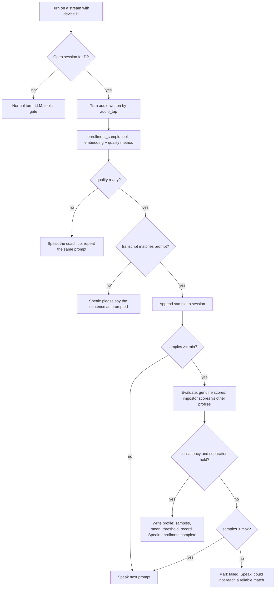
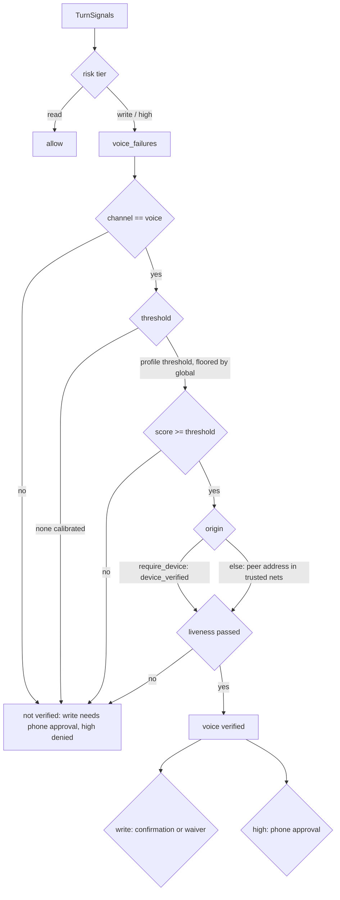

# Device-bound sessions and admin-run voice enrollment

A speaker's session is tied to the key in its YubiKey, and voices are enrolled
in a measured session run by an admin. This doc covers both. `DEVICE_IDENTITY.md`
covers the key and the challenge. `VOICE_ENROLLMENT.md` covers the enrollment
procedure. `THREAT_MODEL.md` covers the threats.

The design rests on three rules. The speaker is trusted for the key it holds,
never for its address or for the voice on the stream (threat 18). The user
token is bound to that key, because it is the only leg of the chain the
hardware can vouch for. The agents' DPoP keys are software in process; they
stop a copied token and do nothing against a compromised process. A voice match
stands on a measured enrollment, never on one global threshold.

## Current state

This is what runs, what it binds, and which switches are off.

| Control | Where | Status |
|---|---|---|
| Speaker holds a key in a YubiKey, signs a 30 s nonce at boot and gets a 10 min credential with `cnf.jkt` | `speaker/modules/speaker/device_identity.py`, `server/modules/orchestrator/core/device_identity.py` | built, off by default (`device_identity_enable`) |
| Credential rides on every Converse call as `x-device-credential` and is re-attested when stale | `speaker/modules/speaker/grpc_client.py`, `speaker/modules/speaker/capture_streamer.py` | built |
| Orchestrator verifies the credential at connect and refuses the stream without one when `DEVICE_IDENTITY_REQUIRE` is on | `server/modules/aiserver/server.py` | built, switch off |
| Voice gate takes the device as origin when `VOICE_GATE_REQUIRE_DEVICE` is on; `device_verified` is bounded by the credential expiry per turn | `server/modules/orchestrator/core/voice_gate.py`, `server/modules/orchestrator/core/utterance.py` | built, switch off; address check until then |
| Per-user threshold from enrollment, floored by `VOICE_GATE_MIN_SCORE` | `server/modules/orchestrator/core/voice_gate.py`, `server/tools_server/tools/get_person_id/get_person_id.py` | built; floor still uncalibrated |
| Assurance record on every gate decision and audit line | `server/modules/orchestrator/core/voice_gate.py` | built; not yet an OPA input |
| Admin-run enrollment session, device-bound, time-boxed and prompted, with quality, prompt match, consistency and separation checks, a profile with threshold and record, and revocation | `server/modules/orchestrator/core/voice_enrollment.py`, `server/scripts/enroll_voice.py`, `server/tools_server/tools/get_person_id/get_person_id.py` | built |
| STS binds the root user token to the device key; the consented client asserts the thumbprint it verified on the stream; `device` and `assurance` travel down the chain; `revoke_device` kills the subtree | `security/delegation/sts.py`, `security/delegation/verify.py`, `security/delegation/admin.py` | built (prototype, `security/` only) |
| Actor leg (gateway, sub-agents, tool tokens) bound to software keys in process (DPoP) | `security/delegation/dpop.py`, `security/delegation/sts.py` | built; stops a copied token, does nothing against a compromised process |
| Liveness, spoken confirmation, phone approval | | not built; the gate stays in monitor mode until they are |

Device identity and the voice gate are built. Their enforcement switches,
`DEVICE_IDENTITY_REQUIRE` and `VOICE_GATE_REQUIRE_DEVICE`, stay off until every
speaker attests. The orchestrator already asserts who is speaking. Here it also
asserts which device the stream came from. No new component is trusted.

## Future state

The structure stays the same. Keys move into hardware, and the orchestrator's
assertions are replaced by proofs wherever a proof is possible.

| Step | What moves | Why |
|---|---|---|
| Speaker as STS client, option (a) under "Who proves possession at the exchange" | The speaker performs the exchange itself over its own channel; the STS checks possession of the device key directly | Removes the orchestrator's assertion of the device, the one place where a compromised orchestrator could lie |
| Re-challenge on the open stream every 60 s (`DEVICE_IDENTITY.md`) | The orchestrator sends a nonce on the live stream; a speaker whose key was pulled cannot sign it | Bounds a pulled key to a minute instead of the credential lifetime |
| TPM 2.0 on the carrier board (`DEVICE_IDENTITY.md`) | The key is generated in the TPM and stays there; no pluggable part; a quote over the boot chain before the credential is issued | Device identity becomes attestation, covering which software runs as well as which key is present |
| SPIFFE/SPIRE for the actor leg | Gateway and sub-agents get X.509-SVIDs from SPIRE with attestation plugins gating issuance; tokens bound with `cnf.x5t#S256` (RFC 8705) over mTLS, per connection; the DPoP software key retires | Closes the "key next to the token" gap on the actor leg; no per-request signing |
| Liveness, spoken confirmation, phone approval | The step-ups the gate already asks for exist; gate moves from monitor to enforce | A recording or a clone stops at the step-up instead of being logged |
| Assurance as an OPA input | Policy reads method, score, threshold source, device and confirmation state per call | The risk tier is decided on what was measured |
| Enrollment from the phone | Open, approve and close sessions from the person's own device | The admin step leaves the host shell; the record is unchanged |

Four things are the same in both pictures. The user token is the leg bound to
hardware. `device` and `assurance` are copied unchanged down the chain.
Revocation walks the issuance registry. The gate never authorizes a write or a
high-risk call on a voice match alone.

## Reasoning

### Binding per connection

Having the agent sign DPoP proofs with the YubiKey does not work. The agent
runs on the server and the key is on the CM5. A YubiKey or TPM also signs about
ten times a second, far below one proof per tool call.

The challenge in `DEVICE_IDENTITY.md` already proves possession once, when the
credential is minted. The speaker signs a nonce with the key. The orchestrator
issues a ten minute credential whose `cnf.jkt` is the key's RFC 7638
thumbprint. Carrying that credential on the stream binds the stream to the key
for ten minutes per signature. mTLS with a device certificate would do the
same. It is not used because Python's gRPC TLS stack cannot reach the YubiKey's
key without a PKCS#11 shim.

### Which leg of the chain gets the hardware key

The user token gets it. That token says user X, at device Y, confirmed by the
voice gate. It is the token an attacker on the server would most want to
replay, and the device is the one claim the hardware key can vouch for. The
actor leg (gateway, sub-agents, tool tokens) stays on the software keys of the
processes that present those tokens, with `act` lineage back to the user token.
Moving those keys into hardware is the SPIFFE step under future state.

### Who proves possession at the exchange

RFC 8693 expects whoever presents a subject token to prove possession of the
key it is bound to. The gateway cannot sign with the speaker's key. There are
three ways around that.

- (a) The speaker exchanges as the delegating client. This is the cleanest,
  but the CM5 needs an STS client role, a secret and a network path to the
  STS, and it has none of them.
- (b) The gateway exchanges with a fresh session assertion signed by the
  device. This costs another YubiKey signature per session and a new artifact
  to define.
- (c) The orchestrator asserts the device thumbprint it verified on the
  stream. It terminates the stream and already asserts the voice identity. The
  STS checks that the thumbprint equals the subject's `cnf.jkt`, that the
  device is registered and not revoked, and that the exchanging client is the
  one the user consented to.

v2.0 uses (c). The orchestrator is already trusted for who is speaking.
Trusting it for which device adds one more fact from the same component. The
cost is that a compromised orchestrator could assert a device it did not see,
as it could already misreport the voice. The thumbprint is on every record, so
a misreport traces to one stream. Option (a) is the target once the speaker is
an STS client.

### Stateless where possible

The device credential is stateless on the orchestrator side. There is one HMAC
key per process and nothing is persisted. The STS device registry maps a
thumbprint to a device id. It loads from the same JSON the orchestrator's
enrollment registry writes, so a revocation is one file write. There is no
grant store. A device revocation walks the issuance registry the DPoP work
already keeps.

### The assurance record

The device binding either holds or does not. A voice match is a cosine
similarity against an enrolled mean. The `assurance` record keeps the two
apart. It carries the method, the score, the device id and thumbprint, and the
confirmation state. It also carries the threshold that applied and whether that
was the user's own or the global floor. Policy reads it by tier. A read runs
on voice alone, a write needs the confirmation and a high-risk call needs the
phone approval. The record never claims more than the gate measured. It lives
in the gate decision and the audit line, and the STS carries it as a claim. The
OPA input does not read it yet.

### Enrollment criteria

Enrollment is identity proofing, so it is measured. A session completes when
four criteria hold.

1. Clip quality. Duration, clipping, level, SNR and silence pass the same
   checks the enrollment coach uses.
2. Prompt match. The transcript overlaps the prompted sentence. Prompts are
   chosen per session, so a replayed recording of something else fails.
3. Consistency. Each sample scores at or above the threshold against the mean
   of the others. This is the genuine score.
4. Separation. Each sample scores below the threshold, by a margin, against
   every other enrolled profile's mean. This is the impostor score. The user's
   threshold is the highest impostor score plus the margin, and never below
   the global floor.

An admin opens the session on the host, bound to one device and a time window.
The record names who opened it, for whom, on which device, how many samples
were taken and what they scored. Embeddings are stored. Audio follows the five
minute cleanup.

Prompted sentences defeat a recording. They do nothing against a cloned voice.
Voice stays an identification signal and never authorizes a write or a
high-risk call alone.

## Flows

### Device-bound session

Revocation is two steps. `enroll_device.py revoke <device_id>` writes the
registry; the orchestrator refuses the next credential check and the STS
refuses the next exchange. `revoke_key(<device jkt>)` at the STS kills every
live token bound to the device and their descendants.

### Enrollment session states

### One enrollment sample

### Voice gate decision with the new signals

## Failure modes

Everything fails closed.

| Condition | Behaviour |
|---|---|
| `DEVICE_IDENTITY_REQUIRE` on, credential missing, expired, forged, for a revoked device | Stream refused with UNAUTHENTICATED and a logged reason; the speaker re-attests and reconnects |
| `VOICE_GATE_REQUIRE_DEVICE` on, no verified device on the turn | Voice not verified; writes need phone approval, high-risk calls denied |
| Credential expires mid-stream | `device_verified` is false on later turns until the speaker reconnects with a fresh credential |
| Enrollment sample from a stream whose device is not the session's device | Rejected and logged; the session is untouched |
| Enrollment session open and the orchestrator has no device identity for the stream | Normal turns; enrollment never engages. `VOICE_ENROLLMENT_ALLOW_UNBOUND_DEVICE` is the bench-only exception |
| STS exchange of a device-bound subject with a missing, different or revoked device thumbprint | `invalid_grant`, logged with the thumbprint |
| Device key revoked at the STS | Every token bound to it and every descendant denylisted; future assertions of that thumbprint refused |

## Limits

- The device binding covers the subject leg. The actor leg still runs on
  software keys in the orchestrator and gateway processes. SPIFFE with
  attested SVIDs is next.
- The orchestrator asserts the device thumbprint. A compromised orchestrator
  could assert a device it did not see, as it could already misreport the
  voice. The thumbprint on every record makes that traceable. It does not make
  it impossible.
- The YubiKey proves which key is present. It does not prove what software is
  running. `DEVICE_IDENTITY.md` covers the gap and the TPM.
- Voice identification is probabilistic and does not resist a cloned voice.
  The assurance record carries that fact to policy on every call.
- Enrollment depends on the prompts and the room. The coach checks catch a
  badly placed microphone. They do not catch a noisy kitchen.

## Threats answered

- Threat 18, origin spoofing. With `VOICE_GATE_REQUIRE_DEVICE` on, the gate
  decides on the device credential and ignores the address.
- Threat 17, identity takeover by stated name. The pending-sample path is
  unchanged. New voices go through the admin-run session with its criteria and
  record.
- Threat 1, token replay, for the user token. The token is bound to a key that
  cannot leave the device instead of a software DPoP key.
- Threat 15, voice spoofing. Prompted sentences defeat a recording at
  enrollment. Cloned voices remain a residual risk and are listed as a limit.
