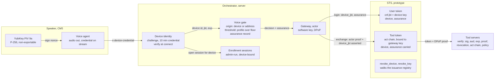
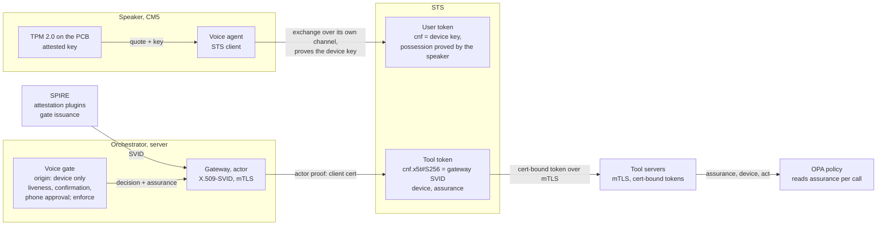
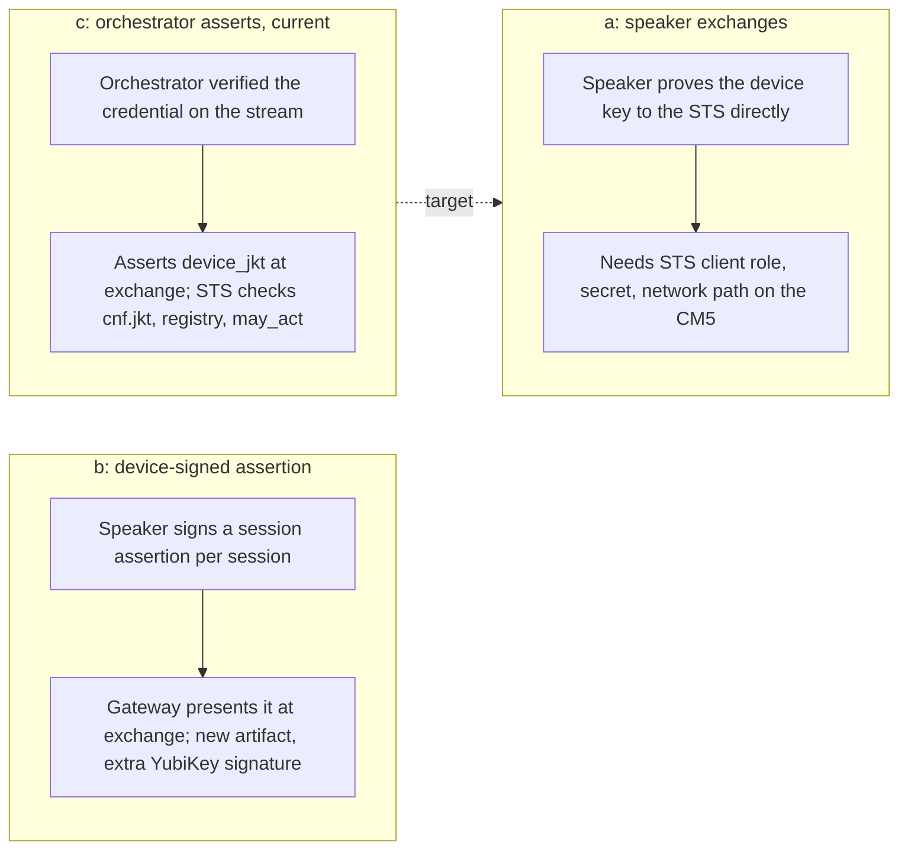
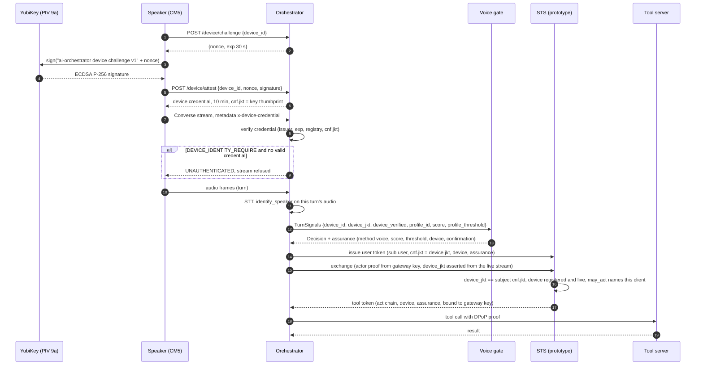
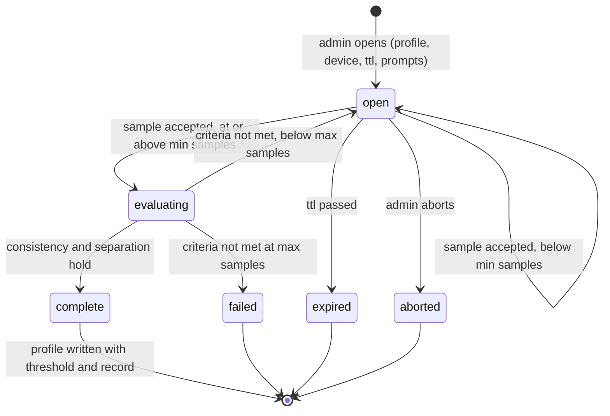
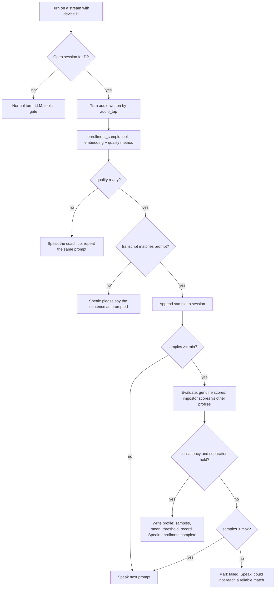
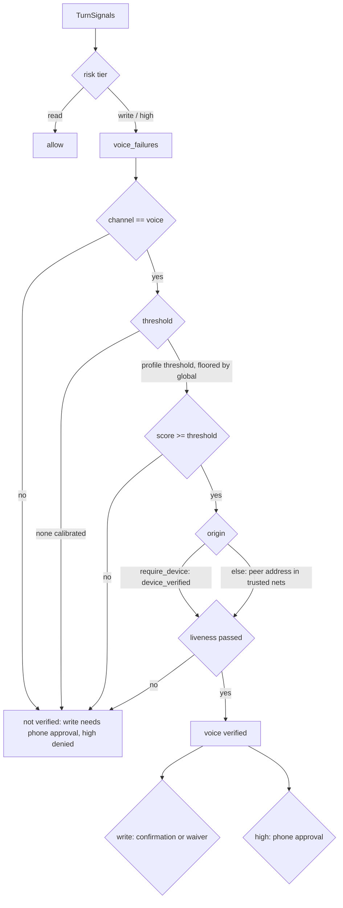

# Device-bound sessions and admin-run voice enrollment

How a speaker's session is bound to its hardware key, and how voices are
enrolled. `DEVICE_IDENTITY.md` covers the key and the challenge,
`VOICE_ENROLLMENT.md` the enrollment procedure, `THREAT_MODEL.md` the threats.

Three things hold. The speaker is trusted for a key it holds, not for its
address or for the voice on the stream (threat 18). The user token is bound to
that key, because it is the only leg of the chain the hardware can vouch for;
the agents' DPoP keys are software in process and stop a copied token, not a
compromised process. A voice match stands on a measured enrollment, not on
one global threshold.

Status key, same as elsewhere in `security/`: built = runs with tests; partial =
runs but with a documented gap; not built = design only.

## Current state

What runs, what it binds, which switches are off.

| Piece | Where | Status |
|---|---|---|
| Speaker holds a P-256 key in YubiKey PIV 9a; signs a 30 s nonce at boot; gets a 10 min credential with `cnf.jkt` | `speaker/.../device_identity.py`, `server/.../device_identity.py` | built, off by default (`device_identity_enable`) |
| Credential rides on every Converse call as `x-device-credential`, re-attested when stale | `grpc_client.py` metadata provider, `capture_streamer.py` | built |
| Orchestrator verifies the credential at connect; refuses the stream without one when `DEVICE_IDENTITY_REQUIRE` | `aiserver/server.py` | built, switch off |
| Voice gate takes the device as origin when `VOICE_GATE_REQUIRE_DEVICE`; `device_verified` bounded by credential expiry per turn | `core/voice_gate.py`, `core/utterance.py` | built, switch off (address check until then) |
| Per-user threshold from enrollment, floored by `VOICE_GATE_MIN_SCORE` | `voice_gate.effective_threshold`, `identify_speaker` | built; floor still uncalibrated |
| Assurance record on every gate decision and audit line | `voice_gate.assurance` | built; not yet an OPA input |
| Admin-run enrollment session: device-bound, time-boxed, prompted; quality, prompt match, consistency, separation; profile with threshold and record; revocation | `core/voice_enrollment.py`, `scripts/enroll_voice.py`, `enrollment_sample` | built |
| STS: root user token bound to the device key; consented client asserts the thumbprint it verified on the stream; `device` and `assurance` down the chain; `revoke_device` kills the subtree | `delegation/sts.py`, `verify.py`, `admin.py` | built (prototype, `security/` only) |
| Actor leg (gateway, sub-agents, tool tokens): bound to software P-256 keys in process (DPoP) | `delegation/dpop.py`, `sts.py` | built; stops copying, not process compromise |
| Liveness, spoken confirmation, phone approval | | not built; gate in monitor mode because of it |

Dashed boxes are built with the enforcement switch off until every speaker
attests. The orchestrator already asserts who is speaking; here it also asserts
which device the stream came from. No new component is trusted.

## Future state

Same structure, keys in hardware, the orchestrator's assertions replaced by
proofs where a proof is possible.

| Step | What moves | Why |
|---|---|---|
| Speaker as STS client (option (a) under "Who proves possession at the exchange") | The speaker performs the exchange itself over its own channel; the STS checks possession of the device key directly | Removes the orchestrator's assertion of the device; the one place today where a compromised orchestrator could lie |
| TPM 2.0 on the carrier board (`DEVICE_IDENTITY.md`) | The key is generated in the TPM and stays there; no pluggable part; a quote over the boot chain before the credential is issued | Device identity becomes attestation, covering which software runs as well as which key is present |
| Prototype B: SPIFFE/SPIRE for the actor leg | Gateway and sub-agents get X.509-SVIDs from SPIRE with attestation plugins gating issuance; tokens bound with `cnf.x5t#S256` (RFC 8705) over mTLS, per connection; the DPoP software key retires | Closes the "key next to the token" gap on the actor leg; no per-request signing |
| Liveness, spoken confirmation, phone approval | The step-ups the gate already asks for exist; gate moves from monitor to enforce | A recording or a clone stops at the step-up instead of being logged |
| Assurance as an OPA input | Policy reads method, score, threshold source, device and confirmation state per call | Risk tier decided on what was measured, not on a flag |
| Enrollment from the phone | Open, approve and close sessions from the person's own device | The admin step leaves the host shell; the record is unchanged |

Unchanged between the two pictures: the user token is the leg bound to
hardware; `device` and `assurance` are copied unchanged down the chain;
revocation walks the issuance registry; the gate never authorizes a write or a
high-risk call on a voice match alone.

## Reasoning

### Bind per connection, not per request

Having the agent sign DPoP proofs with the PIV key does not work: the agent
runs on the server and the key is on the CM5, and a PIV or TPM key signs about
ten times a second, far below one proof per tool call.

The challenge in `DEVICE_IDENTITY.md` already proves possession once, when the
credential is minted: the speaker signs a nonce with the key, the orchestrator
issues a ten minute credential whose `cnf.jkt` is the key's RFC 7638
thumbprint. Carrying that credential on the stream binds the stream to the key
for ten minutes per signature. mTLS with a device certificate would do the
same; it is not used because the YubiKey's key is not reachable from Python's
gRPC TLS stack without a PKCS#11 shim.

### Which leg of the chain gets the hardware key

The user token: user X, at device Y, confirmed by the voice gate. It is the
token an attacker on the server would most want to replay, and the device is
the one claim the hardware key can vouch for. The actor leg (gateway,
sub-agents, tool tokens) stays on the software keys of the processes that
present those tokens, with `act` lineage back to the user token. Moving those
keys into hardware is prototype B (SPIFFE), under future state.

### Who proves possession at the exchange

RFC 8693 expects whoever presents a subject token to prove possession of the
key it is bound to. The gateway cannot sign with the speaker's key. Three
options:

- (a) The speaker exchanges as the delegating client. Cleanest, but the CM5
  needs an STS client role, a secret and a network path to the STS, none of
  which it has.
- (b) The gateway exchanges with a fresh session assertion signed by the
  device. Another YubiKey signature per session and a new artifact to define.
- (c) The orchestrator, which terminates the stream and already asserts the
  voice identity, asserts the device thumbprint it verified on that stream.
  The STS checks that it equals the subject's `cnf.jkt`, that the device is
  registered and not revoked, and that the exchanging client is the one the
  user consented to.

v2.0 uses (c). The orchestrator is already trusted for who is speaking;
trusting it for which device adds a fact, not a component. The cost: a
compromised orchestrator could assert a device it did not see, as it could
already misreport the voice. The thumbprint is on every record, so a misreport
traces to one stream. (a) is the target once the speaker is an STS client.

### Stateless where possible

The device credential is stateless on the orchestrator side: one HMAC key per
process, nothing persisted. The STS device registry maps thumbprint to device
id and loads from the same JSON the orchestrator's enrollment registry writes,
so a revocation is one file write. No grant store; a device revocation walks
the issuance registry the DPoP work already keeps.

### The assurance record

The device binding either holds or does not. A voice match is a cosine
similarity against an enrolled mean. The `assurance` record keeps the two
apart: method, score, the threshold that applied and whether it was the user's
own or the global floor, device id and thumbprint, confirmation state. Policy
reads it by tier: a read runs on voice alone, a write needs the confirmation,
a high-risk call needs the phone approval. It never claims more than the gate
measured. It lives in the gate decision and the audit line, and the STS carries
it as a claim; the OPA input does not read it yet.

### Enrollment criteria

Enrollment is identity proofing, so it is measured. A session completes when
four criteria hold.

1. Clip quality: duration, clipping, level, SNR, silence, the same checks as
   the enrollment coach.
2. Prompt match: the transcript overlaps the prompted sentence. Prompts are
   chosen per session, so a replayed recording of something else fails.
3. Consistency: each sample against the mean of the others (the genuine
   score) is at or above the threshold.
4. Separation: each sample against every other enrolled profile's mean (the
   impostor score) is below the threshold by a margin. The user's threshold is
   the highest impostor score plus the margin, never below the global floor.

An admin opens the session on the host, bound to one device and a time window.
The record names who opened it, for whom, on which device, how many samples,
what scores. Embeddings are stored; audio follows the five minute cleanup.

Prompted sentences defeat a recording, not a clone. Voice stays an
identification signal and never authorizes a write or a high-risk call alone.

## Flows

### Device-bound session

Revocation: `enroll_device.py revoke <device_id>` writes the registry; the
orchestrator refuses the next credential check and the STS refuses the next
exchange; `revoke_key(<device jkt>)` at the STS kills every live token bound to
the device and their descendants.

### Enrollment session, states

### Enrollment sample, one turn

### Voice gate decision with the new signals

## Failure modes

Everything fails closed.

| Condition | Behaviour |
|---|---|
| `DEVICE_IDENTITY_REQUIRE` on, credential missing, expired, forged, for a revoked device | Stream refused with UNAUTHENTICATED and a logged reason; the speaker re-attests and reconnects |
| `VOICE_GATE_REQUIRE_DEVICE` on, no verified device on the turn | Voice not verified: writes need phone approval, high-risk calls denied |
| Credential expires mid-stream | `device_verified` is false on later turns until the speaker reconnects with a fresh credential |
| Enrollment sample from a stream whose device is not the session's device | Rejected and logged; the session is untouched |
| Enrollment session open and the orchestrator has no device identity for the stream | Normal turns; enrollment never engages (unless `VOICE_ENROLLMENT_ALLOW_UNBOUND_DEVICE`, a development switch, is set) |
| STS exchange of a device-bound subject with a missing, different or revoked device thumbprint | `invalid_grant`, logged with the thumbprint |
| Device key revoked at the STS | Every token bound to it and every descendant denylisted; future assertions of that thumbprint refused |

## Limits

- The device binding covers the subject leg. The actor leg still runs on
  software keys in the orchestrator and gateway processes. SPIFFE with
  attested SVIDs (prototype B) is next.
- The orchestrator asserts the device thumbprint. A compromised orchestrator
  could assert a device it did not see, as it could already misreport the
  voice. The thumbprint on every record makes that traceable, not impossible.
- The YubiKey is device identity, not attestation: which key, not what
  software. `DEVICE_IDENTITY.md` covers the gap and the TPM.
- Voice identification is probabilistic and does not resist a cloned voice.
  The assurance record is there so policy never forgets it.
- Enrollment depends on the prompts and the room. The coach checks catch a
  badly placed microphone, not a noisy kitchen.

## Threats answered

- 18 (origin spoofing): with `VOICE_GATE_REQUIRE_DEVICE` on, the gate decides
  on the device credential rather than the address.
- 17 (identity takeover by stated name): the pending-sample path is unchanged,
  and new voices go through the admin-run session with its criteria and
  record.
- 1 (token replay), for the user token: it is bound to a key that cannot leave
  the device rather than to a software DPoP key.
- 15 (voice spoofing): prompted sentences defeat a recording at enrollment.
  Cloned voices remain a residual risk and are listed as a limit.
