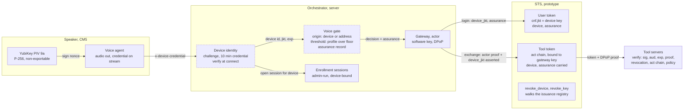
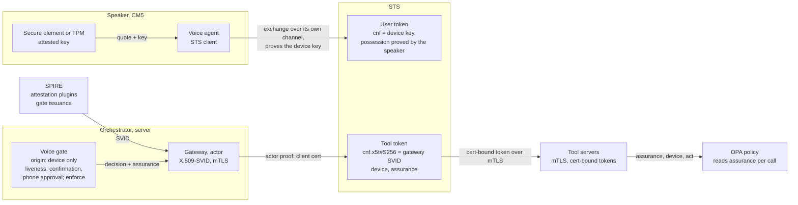
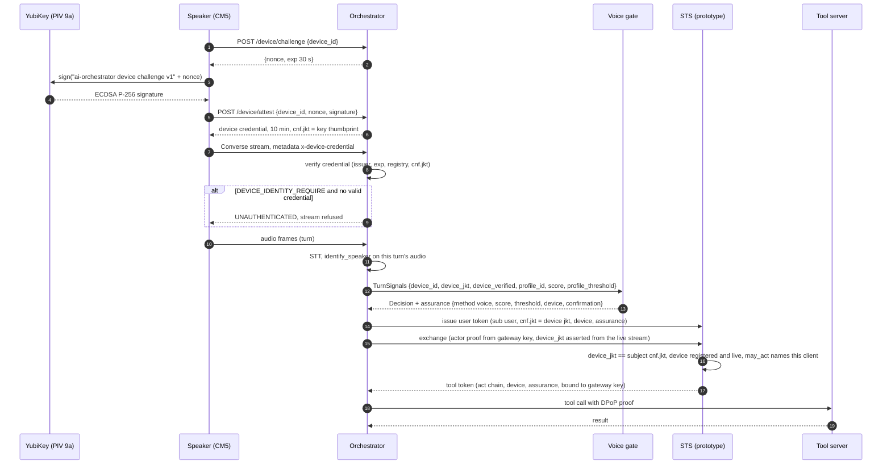
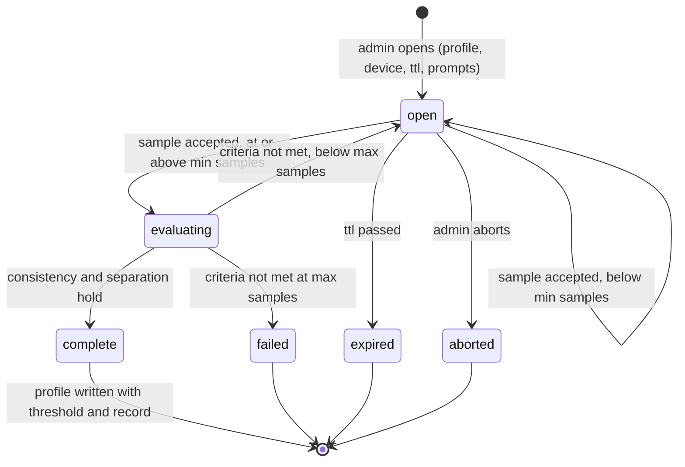
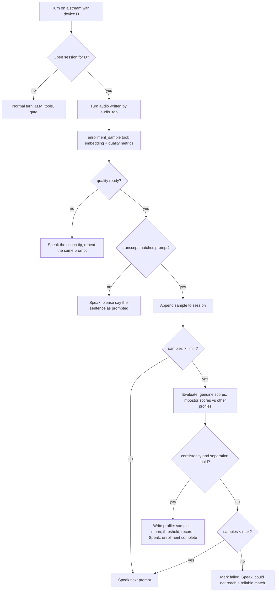
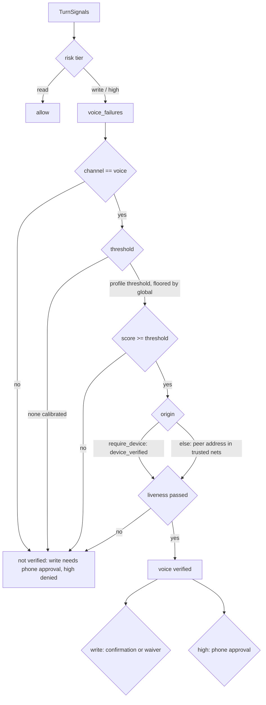

# Device-bound sessions and admin-run voice enrollment

Device-bound sessions and admin-run voice enrollment in ai-orchestrator: the
problem, the current state as of v2.0, the target state, and the reasoning
behind the choices. This page is the reasoning; `DEVICE_IDENTITY.md` stays the reference for the key and the
challenge, `VOICE_ENROLLMENT.md` for the enrollment procedure, and
`THREAT_MODEL.md` for the threats each control answers.

Status key, same as elsewhere in `security/`: built = runs with tests; partial =
runs but with a documented gap; not built = design only.

## 1. The problem

Two facts about the system before this change, both documented and both wrong
to leave as they were:

1. The speaker was trusted by where it was and who was talking, not by what it
   was. The YubiKey challenge existed (`DEVICE_IDENTITY.md`), the orchestrator
   verified the credential at connect and logged it, and then nothing used it:
   the speaker did not send it on the stream, the voice gate still decided on
   the gRPC peer address, and no token was bound to the device key. Threat 18.
2. Every token in the delegation prototype was bound to a software key held in
   the process that presents it (`delegation/dpop.py`, PR #16). That stops a
   copied token. It does not stop an attacker inside the process, who holds the
   key and signs proofs as the process does. The PR said so. The hardware key
   existed on the speaker and was not connected to any token.

A third fact made the voice signal weaker than it looked: the gate's match
threshold was one global number, uncalibrated, with no enrollment procedure
behind it. "I'm Alice" recorded a pending sample for an admin to approve, one
at a time, with no quality bar, no separation check against the other voices in
the house, and no record of who approved what on which device.

## 2. Current state (v2.0, merged 2026-11-07)

What runs today, what it binds, and which switches are off. Status per the
key above.

| Piece | Where | Status |
|---|---|---|
| Speaker holds a P-256 key in YubiKey PIV 9a; signs a 30 s nonce at boot; gets a 10 min credential with `cnf.jkt` | `speaker/.../device_identity.py`, `server/.../device_identity.py` | built, off by default (`device_identity_enable`) |
| Credential rides on every Converse call as `x-device-credential`, re-attested when stale | `grpc_client.py` metadata provider, `capture_streamer.py` | built |
| Orchestrator verifies the credential at connect; refuses the stream without one when `DEVICE_IDENTITY_REQUIRE` | `aiserver/server.py` | built, switch off |
| Voice gate takes the device as origin when `VOICE_GATE_REQUIRE_DEVICE`; `device_verified` bounded by credential expiry per turn | `core/voice_gate.py`, `core/utterance.py` | built, switch off (address check until then) |
| Per-user threshold from enrollment, floored by `VOICE_GATE_MIN_SCORE` | `voice_gate.effective_threshold`, `identify_speaker` | built; floor still uncalibrated |
| Assurance record on every gate decision and audit line | `voice_gate.assurance` | built; not yet an OPA input |
| Admin-run enrollment session: device-bound, time-boxed, prompted; quality, prompt match, consistency, separation; profile with threshold and record; revocation | `core/voice_enrollment.py`, `scripts/enroll_voice.py`, `enrollment_sample` | built |
| STS: root user token bound to the device key; consented client asserts the thumbprint it verified on the stream; `device` and `assurance` down the chain; `revoke_device` kills the subtree | `delegation/sts.py`, `verify.py`, `admin.py` | built (prototype, `security/` only) |
| Actor leg (gateway, sub-agents, tool tokens): bound to software P-256 keys in process (DPoP) | `delegation/dpop.py`, `sts.py` | built; stops copying, not process compromise |
| Liveness, spoken confirmation, phone approval | | not built; gate in monitor mode because of it |

Dashed: built, enforcement switch off until every speaker attests. Everything
else in the picture runs when the switches are on. The trust the picture
adds is one fact, not one party: the orchestrator already asserts who is
speaking; it now also asserts which device the stream came from.

## 3. Future state (target)

The same shape with the keys moved and the orchestrator's assertions
replaced by proofs where a proof is possible.

| Step | What moves | Why |
|---|---|---|
| Speaker as STS client (option (a) in 4.3) | The speaker performs the exchange itself over its own channel; the STS checks possession of the device key directly | Removes the orchestrator's assertion of the device; the one place today where a compromised orchestrator could lie |
| Secure element or SPI TPM on the carrier board (`DEVICE_IDENTITY.md`) | Key in silicon, no pluggable part; with a TPM, a quote over the boot chain before the credential is issued | Device identity becomes attestation: which software, not only which key |
| Prototype B: SPIFFE/SPIRE for the actor leg | Gateway and sub-agents get X.509-SVIDs from SPIRE with attestation plugins gating issuance; tokens bound with `cnf.x5t#S256` (RFC 8705) over mTLS, per connection; the DPoP software key retires | Closes the "key next to the token" gap on the actor leg; no per-request signing |
| Liveness, spoken confirmation, phone approval | The step-ups the gate already asks for exist; gate moves from monitor to enforce | A recording or a clone stops at the step-up instead of being logged |
| Assurance as an OPA input | Policy reads method, score, threshold source, device and confirmation state per call | Risk tier decided on what was measured, not on a flag |
| Enrollment from the phone | Open, approve and close sessions from the person's own device | The admin step leaves the host shell; the record is unchanged |

What does not change between the two pictures: the user token is the leg
that reaches hardware; `device` and `assurance` travel unchanged down the
chain; revocation walks the issuance registry; the gate never authorizes a
write or a high-risk call on a voice match alone.

## 4. Reasoning

### 4.1 Bind per connection, not per request

The obvious version of "bind the agent to the YubiKey" is to have the agent
sign DPoP proofs with the PIV key. Two things are wrong with it. The agent
process runs on the server; the key is on the CM5. And a PIV or TPM key signs on
the order of ten operations a second, so a proof per tool call is a ceiling the
system would hit in normal use.

The challenge flow in `DEVICE_IDENTITY.md` is already a proof of possession,
once, when the credential is minted: nonce, ECDSA over the nonce with the key
that cannot leave the YubiKey, ten minute credential with `cnf.jkt` equal to the
key's RFC 7638 thumbprint. Sending that credential on the stream binds the
stream to the key for the credential's lifetime at the cost of one signature
per ten minutes. mTLS with the device certificate would give the same binding
and is the shape the target diagram in `DIAGRAMS.md` names; it is not taken here
because the YubiKey's private key is not reachable from Python's gRPC TLS stack
without a PKCS#11 shim, and the credential gives the same guarantee today.

### 4.2 Which leg of the chain gets the hardware key

The user token: "user X, present at device Y, confirmed by the voice gate." It
is the token an attacker on the server would most like to replay, and it is the
one fact the hardware can speak to. The actor leg (gateway, sub-agents, tool
tokens) stays bound to the software keys of the processes that present them,
with `act` lineage back to the device-bound user token. Moving those keys into
hardware is prototype B (SPIFFE), not this change.

### 4.3 Who proves possession at the exchange

RFC 8693 expects the party presenting a subject token to prove possession of
the key it is bound to. The gateway cannot sign with the speaker's key. Three
ways out were considered:

- (a) The speaker performs the exchange itself, as the delegating client. Clean,
  and it gives the CM5 an STS client role, a secret and a network path to the
  STS it does not have today.
- (b) The gateway exchanges, presenting a fresh device-signed session assertion.
  Another signature from the YubiKey per session, and a new artifact to define.
- (c) The orchestrator, which terminates the stream and already asserts the
  voice identity, asserts the device thumbprint it verified on that stream. The
  STS checks that the thumbprint equals the subject token's `cnf.jkt`, that the
  device is registered and not revoked, and that the exchanging client is the
  one the user consented to.

v2.0 takes (c). The orchestrator is already the trusted asserting party for
who is speaking; making it the asserting party for which device is on the
stream adds no new trust, only a new fact. The cost is explicit: a compromised
orchestrator can lie about the device, which is the same trust the system
places in it today for the voice identity, and every record carries the
thumbprint so the lie is at least attributable to one stream. (a) stays the
target once the speaker is an STS client.

### 4.4 Stateless where possible

The device credential is stateless on the orchestrator side (HMAC key per
process, nothing persisted). The STS device registry is a map of thumbprint to
device id, loaded from the same JSON the orchestrator's enrollment registry
writes, so revocation is one file write. No grant store was added: a device
revocation walks the issuance registry that PR #16 already keeps.

### 4.5 Two facts of different strength, and the token says which

The device binding is hardware-rooted and binary. Voice identification is a
cosine similarity against an enrolled mean, probabilistic by nature. The
`assurance` record keeps them apart: `method: voice`, the score, the threshold
that applied and whether it was the user's own or the global floor, the device
id and thumbprint, and whether a confirmation happened. Policy reads it by risk
tier: a read runs on voice alone, a write needs the confirmation, a high-risk
call needs the phone approval. The token never claims more than the gate
measured. Today the record lives in the gate decision and the audit line,
and the STS carries it as a claim; the OPA input does not read it yet.

### 4.6 Enrollment is identity proofing, so it is measured

The existing path accepted one sample at a time with no criteria. The new path
has four, and a session completes only when all hold:

1. Quality per clip: duration, clipping, level, signal to noise and silence, the
   same checks the enrollment coach already made.
2. Prompt match per clip: the transcript must overlap the prompted sentence.
   This is what makes a replayed recording fail: the prompts are chosen per
   session and the clip has to say them.
3. Consistency: the mean similarity of each sample to the mean of the others
   (the genuine score) must clear the threshold with the whole sample set.
4. Separation: the new profile's samples against every other enrolled
   profile's mean (the impostor score) must sit below the threshold by a
   margin. The per-user threshold is set from this: the highest impostor
   score plus the margin, never below the global floor.

The session is opened by an admin on the host, bound to one device and to a
time window, and the record says who opened it, for whom, where, how many
samples were taken and the scores that resulted. Embeddings are stored, never
audio; the clip files follow the existing five minute cleanup.

What enrollment does not do: beat a cloned voice. Prompted sentences defeat a
recording; they do not defeat synthesis. Voice remains an identification signal
and never the sole authorizer of a write or a high-risk call.

## 5. Flows

### 5.1 Device-bound session

Revocation: `enroll_device.py revoke <device_id>` writes the registry; the
orchestrator refuses the next credential check and the STS refuses the next
exchange; `revoke_key(<device jkt>)` at the STS kills every live token bound to
the device and their descendants.

### 5.2 Enrollment session, states

### 5.3 Enrollment sample, one turn

### 5.4 Voice gate decision with the new signals

## 6. Failure modes

Everything new fails closed.

| Condition | Behaviour |
|---|---|
| `DEVICE_IDENTITY_REQUIRE` on, credential missing, expired, forged, for a revoked device | Stream refused with UNAUTHENTICATED and a logged reason; the speaker re-attests and reconnects |
| `VOICE_GATE_REQUIRE_DEVICE` on, no verified device on the turn | Voice not verified: writes need phone approval, high-risk calls denied |
| Credential expires mid-stream | `device_verified` is false on later turns until the speaker reconnects with a fresh credential |
| Enrollment sample from a stream whose device is not the session's device | Rejected and logged; the session is untouched |
| Enrollment session open and the orchestrator has no device identity for the stream | Normal turns; enrollment never engages (unless `VOICE_ENROLLMENT_ALLOW_UNBOUND_DEVICE`, a development switch, is set) |
| STS exchange of a device-bound subject with a missing, different or revoked device thumbprint | `invalid_grant`, logged with the thumbprint |
| Device key revoked at the STS | Every token bound to it and every descendant denylisted; future assertions of that thumbprint refused |

## 7. Honest limits

- The device binding anchors the subject leg. The actor leg still trusts the
  orchestrator and gateway processes, which hold software keys. SPIFFE and
  attested SVIDs are the next step for that (prototype B).
- The orchestrator asserts the device thumbprint at the STS. A compromised
  orchestrator can assert a device it did not see. Same trust as the voice
  identity today; attributable, not prevented.
- Device identity, not attestation: the YubiKey proves which key, not what
  software is running. `DEVICE_IDENTITY.md` says why and what the target is.
- Voice identification is probabilistic and does not resist a cloned voice.
  The assurance record exists so that nothing downstream can forget that.
- Enrollment is only as good as the prompts and the room. The coach checks
  catch a bad microphone position; they do not make a noisy kitchen quiet.

## 8. Threats answered

- 18 (origin spoofing): the gate decides on the device credential, not the
  address, when `VOICE_GATE_REQUIRE_DEVICE` is on.
- 17 (identity takeover by stated name): the pending-sample path is unchanged;
  the admin-run session is the path for new voices, with criteria and a record.
- 1 (token replay) for the user token: bound to a key that cannot leave the
  device; the software DPoP key no longer stands in for it.
- 15 (voice spoofing): prompted sentences defeat a recording at enrollment;
  cloned voices remain the residual risk, carried as a stated limit.
