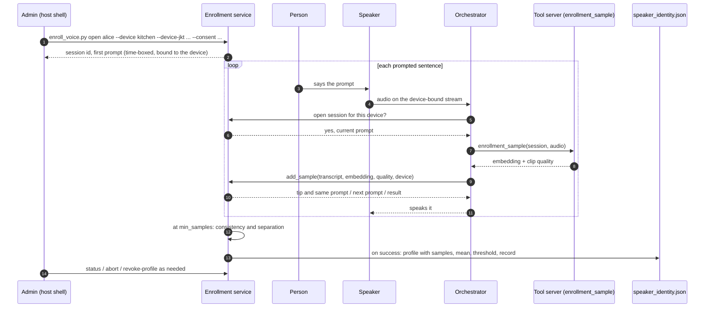
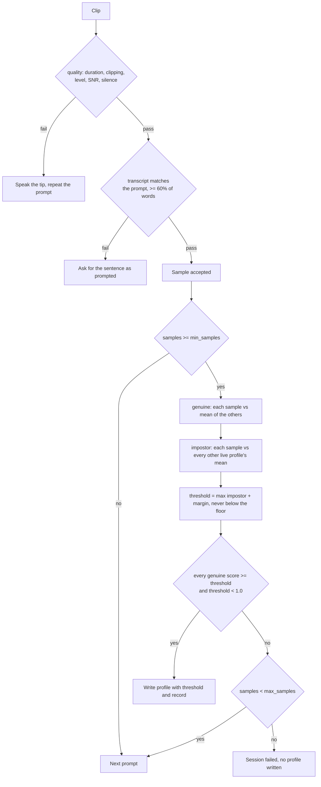
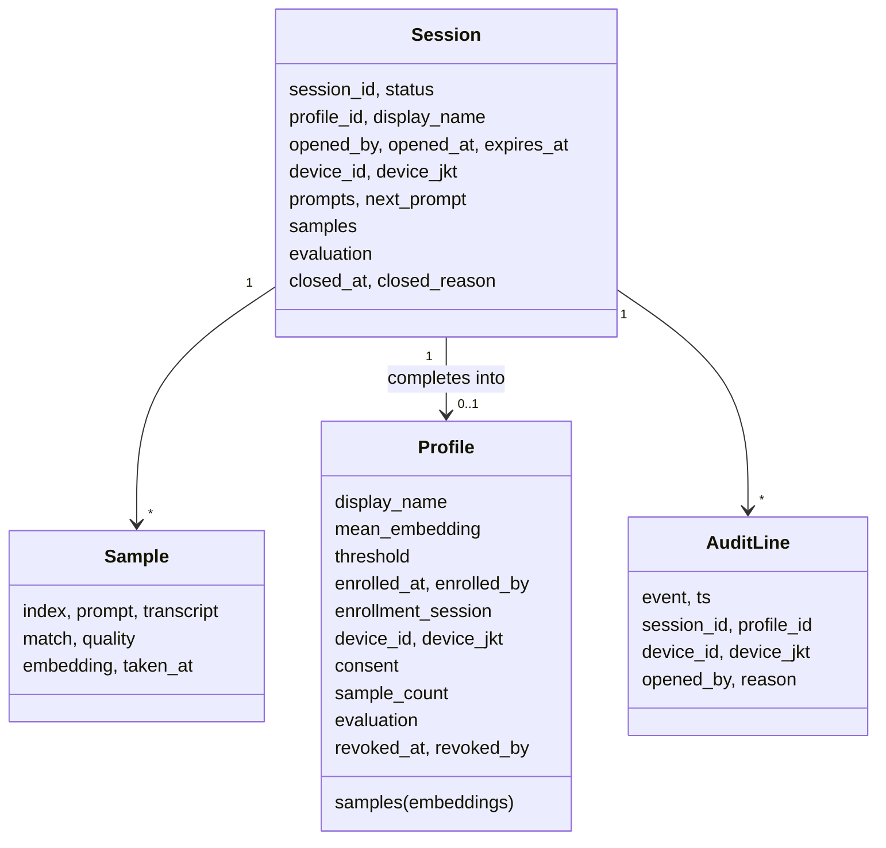
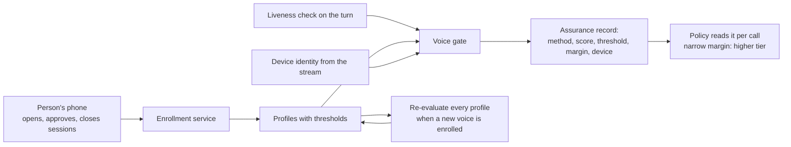

# Voice enrollment

How a voice becomes a profile the voice gate trusts: the procedure, the
criteria, the record. Reasoning is in `SESSION_BINDING.md` under "Enrollment
criteria". Code: `core/voice_enrollment.py` (sessions, criteria, profile
writes), `scripts/enroll_voice.py` (admin), `enrollment_sample` in
`tools_server/tools/get_person_id` (hidden from the model),
`core/utterance.py` (`_enrollment_turn`).

## Current state

### Two paths, one record

| Path | Who starts it | What it produces | Status |
|---|---|---|---|
| Stated name ("I'm Alice") | the person, mid-conversation | one pending sample; joins nothing until `scripts/approve_enrollment.py approve` | built (unchanged) |
| Admin session | an admin on the host, for one person on one speaker | a profile with its own threshold and a record, after the criteria hold | built (v2.0) |

New voices go through the admin session. The stated-name path stays for
adding a sample to an existing profile, one approval at a time.

### Procedure



1. On the server host, open the session for the speaker the person will talk
   to; `--device-jkt` pins it to that speaker's current key.

   ```
   python scripts/enroll_voice.py open alice --name "Alice" --device kitchen \
       --device-jkt <thumbprint from scripts/enroll_device.py list> \
       --consent "asked and agreed in the kitchen, 2026-11-07" --ttl 900
   ```

   Prints the session id and the first prompt. One open session per device
   and per profile; an existing profile needs `--replace`.

2. The person wakes the speaker and says the prompt. With a session open for
   this device, the orchestrator treats the turn as a sample, with no model,
   tools or history. It gets the embedding and clip quality from
   `enrollment_sample`, checks the transcript against the prompt, and speaks
   back a tip and the same prompt, the next prompt, or the result.

3. From `min_samples` (default 6) the session is evaluated after every
   accepted clip. It completes when the criteria hold, fails at `max_samples`
   (default 12), expires at the time limit, or is aborted:

   ```
   python scripts/enroll_voice.py status <session_id>
   python scripts/enroll_voice.py abort <session_id>
   ```

4. On completion the profile is written to `speaker_identity.json` and the
   gate uses it on the next turn. Revoking keeps the record and stops
   identification:

   ```
   python scripts/enroll_voice.py revoke-profile alice
   ```

### Criteria



A clip is accepted when all of these hold (`EnrollmentPolicy`):

| Check | Default | Why |
|---|---|---|
| duration | 2 to 8 s | shorter embeds badly, longer drifts |
| clipping ratio | at most 1% | distorted audio embeds as a different voice |
| level | at least -38 dBFS | too quiet means the room, not the person |
| estimated SNR | at least 10 dB | noise floor shows up in the embedding |
| silence ratio | at most 65% | the clip has to contain the sentence |
| prompt match | at least 60% of the prompt's words in the transcript | a replayed recording of something else fails; a sentence read from the prompt passes |

A session completes when all of these hold over the accepted samples:

| Check | Rule |
|---|---|
| count | at least `min_samples` |
| consistency (genuine) | every sample scores at or above the threshold against the mean of the other samples |
| separation (impostor) | the threshold is the highest score of any sample against any other live profile's mean, plus `margin` (default 0.03) |
| floor | the threshold is never below `VOICE_GATE_MIN_SCORE`; with no other profile enrolled the threshold is the floor and the record says separation was not measurable |
| ceiling | a threshold at or above 1.0 means another enrolled voice is indistinguishable: the session cannot complete |

The threshold that results is the person's own. The gate applies the higher of
it and the global floor (`voice_gate.effective_threshold`).

### The record



Each profile written by a session carries:

```
display_name, samples (embeddings), mean_embedding, threshold,
enrolled_at, enrolled_by, enrollment_session, device_id, device_jkt,
consent, sample_count, evaluation {genuine_min, genuine_mean, impostor_max,
impostor_pairs, threshold, ok, reasons}, revoked_at (null), revoked_by
```

Sessions (`voice_enrollment_sessions.json`) keep every accepted sample with
its prompt, transcript, match score, quality metrics and time, and the
evaluation that closed the session. The audit log (`voice_enrollment.audit`)
records opened, each sample accepted or rejected with the reason, needs-more,
complete, failed, expired, aborted and profile revoked, each with the session,
profile, device and admin.

Embeddings are stored and audio is not. The WAV file each turn produces is
removed by the normal five minute cleanup of the client audio directory.

### Fail closed

- A sample from a stream whose device id or thumbprint is not the session's
  is refused; the session is untouched.
- A stream with no verified device identity never enters enrollment.
  `VOICE_ENROLLMENT_ALLOW_UNBOUND_DEVICE` matches a session opened for device
  `unbound` to any stream; bench use only, off in the house.
- A clip that fails quality or the prompt check is spoken back, not stored.
- A session that cannot meet the criteria by `max_samples` fails and writes
  no profile. A revoked profile never matches and is never an impostor
  reference.

### Limits

- Prompted sentences defeat a replayed recording but not a cloned voice.
  Voice remains an identification signal; writes still require the
  confirmation and high-risk calls still require the phone approval, whatever
  the score.
- The transcript check is lenient (word overlap, order ignored) so that STT
  errors do not block enrollment. It is not a liveness check.
- Separation is measured against the voices enrolled at the time. Enrolling a
  similar voice later does not re-evaluate the earlier thresholds;
  `scripts/calibrate_voice_threshold.py` reports the overall picture.
- The admin step is a script run on the host.

## Future state



- A liveness check on each turn, so that a recording is rejected before the
  voice match is considered.
- Sessions opened, approved and closed from the person's own phone through the
  phone approval flow. The record is unchanged.
- Re-evaluation when a new voice is enrolled: each existing profile's
  separation is measured again against the new voice, and any threshold that
  no longer holds is flagged for re-enrollment.
- The assurance record as a policy input, so that a profile enrolled with a
  narrow separation margin is held to a higher tier than one with a wide
  margin.
- Voice treated as one factor among several, alongside device identity from
  the stream (built), liveness and the step-ups. The score alone never
  authorizes a write.
