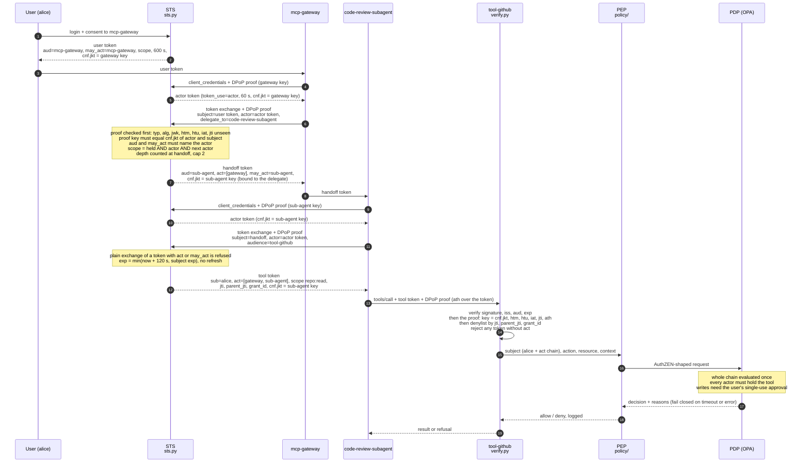
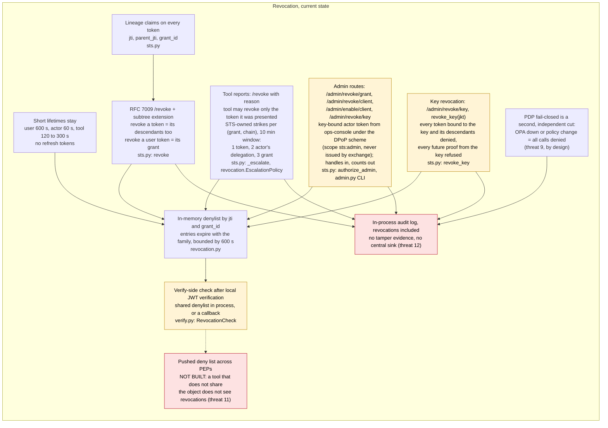
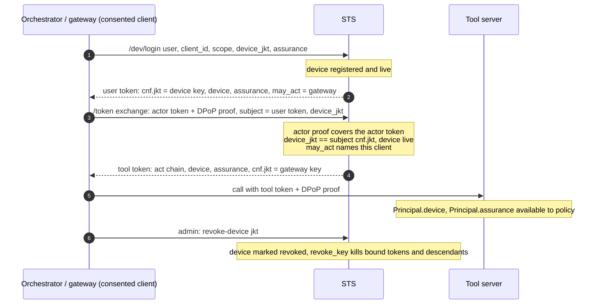
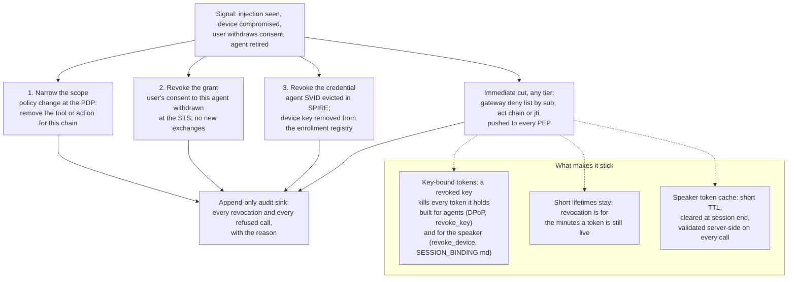

# RFC 8693 delegation for agents

The user consents to an agent. The agent exchanges the user's token for a
short-lived, audience-scoped token that carries an `act` claim. A tool server
checks both who the user is (`sub`) and which agents are acting (`act`), and
rejects any token without `act`. The chain can go one level deeper:
user > mcp-gateway > code-review-subagent, with access narrowing at each hop.



Every token is bound to a key (`cnf.jkt`) and every call carries a DPoP proof
signed with that key, so a copied token is useless on its own. See "Sender
constraint (DPoP)" below. In the diagram, the PEP is the policy enforcement
point in the tool server and the PDP is the policy decision point it asks,
both in `../policy/`.

## Run

```
python -m venv .venv && .venv\Scripts\activate      # Windows
pip install -r requirements.txt
python demo.py          # chain, attack table and a revocation, no servers needed
python -m pytest -q     # 87 tests
python sts.py           # optional: STS on 127.0.0.1:8099; set STS_CLIENT_MCP_GATEWAY etc. (secrets) and STS_JKT_MCP_GATEWAY etc. (key thumbprints) first; nothing is printed
python dpop.py keygen gateway.pem   # a client's DPoP key as a PEM only its owner can read; prints the thumbprint to register as STS_JKT_*
```

## Files

| File | What it does |
|---|---|
| `sts.py` | The STS. Client credentials for actor tokens, token exchange with the delegation rules, DPoP binding of every token it issues, JWKS, and an audit log of every decision with its reason. The signing key, client secrets and client DPoP keys live in memory; this is dev only. |
| `dpop.py` | RFC 9449 proofs. `make_proof` on the client side, `verify_proof` on the STS and tool side, the bounded `ReplayCache`, the RFC 7638 thumbprint, and `keygen` for the one out-of-process path. |
| `verify.py` | The upstream check a tool server runs. It accepts tokens from this STS by key or from Keycloak by JWKS URL, takes the request's DPoP proof for a key-bound token, and has an optional `revocation=` hook. |
| `revocation.py` | The in-memory denylist of jtis and grant ids with expiries, the STS's record of issued tokens and the key each is bound to, and the `EscalationPolicy` defaults. The record is what walks a token's descendants. |
| `admin.py` | Operator CLI for the admin routes. It gets an ops-console actor token with a DPoP proof and calls the routes under the DPoP scheme. Run `python admin.py revoke-grant <id>` from here, or `python -m delegation.admin ...` from `security/`. |
| `demo.py` | End-to-end run and attack table. |
| `tests/` | Happy paths and attacks. |
| [`keycloak/`](keycloak/README.md) | Keycloak 26.8 compose and steps for hop 1, a preview feature. |

## Rules the STS enforces

- Delegation needs an `actor_token`, and it must belong to the authenticated client.
- The subject token's `aud` and `may_act` must both name the actor.
- Access only narrows. Scope must be held by the subject and registered for the actor, and for the next actor on a handoff.
- Audience must be registered for the actor. `delegate_to` must be on its allow list.
- A plain exchange of a token carrying `act` or `may_act` is refused, so the chain cannot be stripped.
- Chain depth is capped at 2 actors, counted when a handoff is issued.
- `exp` = min(now + actor TTL, subject exp). No refresh tokens.
- The subject token, its grant, and every token in its lineage must be unrevoked.
- Every `/token` call carries a DPoP proof. The proof key must be the one the actor token and the subject token are bound to (`cnf.jkt`), and a token without `cnf` is refused. The issued token is bound to the key of whoever will present it next.

## Revocation



Every token carries three lineage claims. `jti` is unique per token. `grant_id`
is minted on the user token at consent and copied unchanged through every
exchange. On exchanged tokens, `parent_jti` is the jti of the subject token
consumed. That is enough to follow a chain downward from any token.

`POST /revoke` (also `STS.revoke`) follows RFC 7009:

- The client authenticates. A bad secret is 401 `invalid_client`.
- An unknown, malformed, forged or already-expired token gets 200 and changes
  nothing, so the response cannot be used to probe. A token signed by another
  issuer (Keycloak, for hop 1) falls in this bucket. This STS cannot revoke
  what it did not issue.
- `token_type_hint` is accepted and ignored. There is one token type and no
  refresh tokens.
- A client may revoke a token it holds, meaning its `client_id` is in `aud` or
  equals the token's `client_id` claim, or any token in whose `act` chain it
  appears. So the gateway can revoke the sub-agent's tool token, and the
  sub-agent can revoke its own tool token. Neither notes-agent nor the
  sub-agent can revoke Alice's user token. A downstream, less trusted actor
  does not get to end the session above it. A genuine token outside that set
  is 400 `unauthorized_client`, as section 2.1 of the RFC says to inform the
  client.

RFC 7009 is silent on exchanged tokens, so this STS extends it. Revoking a token
revokes every token exchanged from it, by lineage. Revoking a user token revokes
its `grant_id`, so every token in that family is dead whether or not the STS
still remembers it. Revoking one handoff leaves its siblings alone.

The admin paths sit outside RFC 7009 and take handles, not token strings.
`STS.revoke_grant(grant_id)` kills a consent. `STS.revoke_client(client_id)`
kills every live token where that client is the actor or appears in `act`, and
refuses it new actor tokens and exchanges until `enable_client`. They are
reachable over HTTP through the `ops-console` client; see "Admin revocation".

The state is `revocation.Denylist`. It holds revoked jtis and grant ids, each
with an expiry equal to the latest `exp` in the revoked family, and prunes them
as they expire. No exchanged token outlives its user token (600 s), so the
list stays bounded no matter how many revocations arrive. Nothing persists. A
restart also rotates the signing key, so nothing outstanding survives it
either.

Enforcement happens in two places.

- `sts.py` refuses an exchange when the subject token, its grant, or any jti
  in its lineage is revoked. It also refuses a revoked client's actor token.
- `verify.py` verifies the JWT locally first, checking signature, issuer,
  audience and expiry, so a forged token never reaches the revocation state.
  Then it consults an optional `RevocationCheck`. There are two
  implementations. The STS denylist shared in process is what `demo.py` does.
  `CallbackRevocationCheck` wraps any callable and stands in for a deny list
  pushed to each PEP, the target under "Future state" below. With no checker
  the verifier stays offline and unaware of revocations. A checker that raises
  is a refusal. Per-call introspection (RFC 7662) was not chosen. It adds a
  network hop to every tool call and makes the STS a central dependency for
  all tools, a second copy of the availability cost the PDP already carries
  (threat 9).

Every revocation decision (revoked, noop, deny) and every refusal on the verify
side is logged with its reason, in the same JSON form as the exchange audit log.

### RFC 7009 compared with this STS

| Topic | RFC 7009 | This STS |
|---|---|---|
| Endpoint and parameters | `POST` to the revocation endpoint; `token` required; `token_type_hint` optional, a wrong hint must not stop the server from finding the token | `POST /revoke`; `token` required (missing or empty is 400 `invalid_request`); `token_type_hint` accepted and ignored, since every token carries its own `token_use` and there is one token type |
| Client authentication and ownership | Client authenticates as for the token endpoint; the server verifies the token was issued to the requesting client, else refuses | Same client secret check as `/token` (401 `invalid_client`). "Issued to" is read as: the client is the holder (named in `aud` or in the `client_id` claim) or any client in the `act` chain. Downstream never revokes upstream |
| Invalid token | Section 2.2: respond 200 whether or not the token was valid, so the client cannot probe | 200 and no change for anything the STS cannot validate: malformed, forged, signed by another issuer, expired, no `jti` |
| Error codes | RFC 6749 section 5.2 codes plus `unsupported_token_type`; no code is bound to "not your token" | `invalid_request`, `invalid_client`, and `unauthorized_client` for a genuine token outside the caller's authority (our choice, the spec leaves it open); `unsupported_token_type` is never returned because hints are ignored |
| Related tokens | Revoking a refresh token SHOULD revoke the access tokens issued with it; revoking an access token MAY revoke its refresh token | No refresh tokens exist. Revoking a token revokes its lineage subtree, and revoking a user token revokes its `grant_id`. That is an extension for exchanged tokens, not a reading of 7009 |
| Immediate effect | Section 2.1: the token is invalidated immediately | Immediate at the STS and at any verifier wired to the denylist; anywhere that is not wired, the token lives until its TTL, at most 600 s |

### Where the denylist lives

The denylist lives in the STS process. `sts.py` writes it. `verify.py` never
imports the STS and reaches the state only through the `RevocationCheck` it
was handed. In `demo.py`
and the tests that object is the STS's own `Denylist`, so the "callback" is a
method call in the same process. Across real PEPs the same seam becomes a push
from the STS to each verifier, or a shared store both read. That transport is
the part that is not built. RFC 7009 section 3 calls the interaction between
the authorization server and the resource servers out of scope. That is why the
spec leaves it open and why `verify.py` takes a protocol instead of an address.

Size is bounded by lifetime, not by traffic. Every entry expires at the latest
`exp` in its family, and no exchanged token outlives the user token it came
from. The set holds at most one user-token lifetime (600 s) of revocations.

### Tool reports and escalation

A tool server is a registered client with no audiences and no scopes
(`tool-github`, `tool-jira`, `tool-fs`), so it can authenticate at `/revoke` but
can exchange nothing. By the ownership rule above it holds exactly the tool
tokens addressed to it. It may revoke the token it was presented and nothing
above it. The handoff, the user token and other tools' tokens are all
`unauthorized_client`, whatever reason it gives.

`/revoke` takes an optional `reason`: `cleanup`, `anomaly` or
`injection_suspected`; anything else is 400 `invalid_request`. The reason is
audited on every revocation. It never widens what the caller may revoke. It
feeds a strike counter the STS owns, keyed by `grant_id` and the actor chain of
the reported token. Strikes count inside `EscalationPolicy.window_s`, default
10 minutes, on the STS clock so tests can move it. `cleanup` never counts.

| Strikes in window | What the STS revokes, on top of the caller's own revocation |
|---|---|
| 1 | nothing more: the presented token only |
| 2 (`handoff_at`) | the immediate actor's delegation: the handoff the token descends from, or, for a one-actor chain, every token that actor exchanged under the grant |
| 3 (`grant_at`) | the grant: the user token and every token under it |

Every step is logged as `revocation_escalation` with the reason, the strike count,
the step and how many jtis were denied. Thresholds and window are the
`EscalationPolicy` dataclass passed to `STS(escalation=...)`.

The trade-off is deliberate. A hostile or buggy tool server can cost the actor
its handoff after two reports and the user their grant after three, inside the
window. Detection happens at the edge, where the tool sees the call. Authority
stays at the center, where the STS applies a policy the tool cannot change. The
blast radius is bounded by that policy, whatever the reporter asks for. A
tool that wants more than this gets `unauthorized_client`.
Repeated reports of the same token count as separate strikes; de-duplicating by
jti would be a reasonable tightening and is not done here.

### Admin revocation

`POST /admin/revoke/grant` (form `grant_id`), `POST /admin/revoke/client` and
`POST /admin/enable/client` (form `client_id`) and `POST /admin/revoke/key`
(form `jkt`) take handles, not token strings, and answer 200 with counts
(`revoked_jtis`, `disabled`, `known`), never token contents. An unknown handle is
200 with zero counts and is audited, so the routes cannot be used to probe.

The credential is an actor token from the `ops-console` client, the only
holder of scope `sts:admin`. It is presented under the `DPoP` scheme with a
proof over it, the resource-server side of RFC 9449, section 7.1. The same
bound token under `Bearer`, or without a fresh proof from its key, is 401
`invalid_dpop_proof`. The dev login and every exchange refuse that scope,
whether requested or held by the subject, so it can never land in a user,
handoff or tool token. No bearer, a user or tool token, a revoked actor token
or one from a disabled client is 401 `invalid_client`. A live actor token from
a client without `sts:admin` is 403 `insufficient_scope`. Both carry RFC 6749
section 5.2 bodies. A user token presented here is 401, "not a client
credential". It is never 403, "a client without the scope", because the holder
of a user token is not the entity this check is about.

Admin uses the same client machinery as every other caller. Admin is a caller with
a credential and a scope, so it gets the same authentication, the same audit
line (`by: ops-console`) and the same revocation. `revoke_client` on
`ops-console` locks the console out; recovery is `enable_client` on the host.
When agents move to SVIDs the console moves with them to an admin
SVID, with nothing special-cased to rewrite. Binding the routes to loopback
would be optional hardening on top; the scope check is the control.

`admin.py` is the thin CLI: `STS_URL`, `STS_CLIENT_OPS_CONSOLE` (secret) and
`STS_KEY_OPS_CONSOLE` (path to the console's DPoP key) from the environment,
one actor token, one call, the JSON answer on stdout.

Keycloak's `/revoke` only knows tokens Keycloak issued. For hop 1 to take part,
this STS would have to do one of two things. It could introspect the subject
token on every exchange. Or it could consume Keycloak admin events (logout,
consent withdrawn) and translate them into grant revocations. Neither is built.
A Keycloak-issued user token revoked at Keycloak still exchanges here until it
expires.

## Sender constraint (DPoP)

A bearer token is good for whoever holds the bytes. Threat 1 in
`THREAT_MODEL.md` is exactly that. A tool token copied out of an agent's
process works at the tool until it expires, 120 to 300 s later. RFC 9449 (DPoP)
closes it by binding a token to a key the client holds. Every request then
carries a short signed proof that the client still holds that key.

It works like this, end to end.

1. Each registered client (`mcp-gateway`, `code-review-subagent`,
   `notes-agent`, the tool servers, `ops-console`) has a key next to its
   secret, generated at startup and kept in the client object. The STS
   registers the key's RFC 7638 thumbprint (`jkt`). The private key stays with
   the client. The thumbprint is the same computation as `key_thumbprint` in
   `server/modules/orchestrator/core/device_identity.py`, so an agent's token
   and the speaker's device credential bind to a key the same way (`cnf.jkt`).
2. Every call to `/token` carries a `DPoP` header. It is a JWT with
   `typ: dpop+jwt`, `alg: ES256`, the public key in the header `jwk`, and the
   claims `jti`, `htm`, `htu` and `iat`. The STS verifies it before it looks
   at any token in the request. A proof that is missing, malformed, older
   than 60 s, replayed or for the wrong URI is 400 `invalid_dpop_proof`.
3. The STS binds what it issues. The actor token carries `cnf.jkt` of the
   proof key, which must be the client's registered key, so a leaked secret
   alone mints nothing. The user token is bound to the key of the agent the
   user consented to, since that agent is its holder. On an exchange the proof
   key must equal `cnf.jkt` of both the actor token and the subject token, and
   a token without `cnf` is refused, so binding cannot be stepped down. The
   tool token is bound to the requesting actor's key. The handoff is bound to
   the delegate's registered key (below).
4. At the tool, `verify.py` sees `cnf.jkt` and requires the request's proof.
   It runs the same checks as the STS plus `ath`, the hash of this exact
   token, and the thumbprint must equal `cnf.jkt`. Then, and only then, the
   revocation check runs. The proved `jkt` is on the `Principal` and in every
   audit line.
5. Admin routes take the actor token under the `DPoP` scheme with a proof
   carrying `ath`. `revoke_key(jkt)`, at `/admin/revoke/key` or `admin.py
   revoke-key`, denylists every live token bound to a key, with its
   descendants, and refuses every future proof from it.

Token responses say `token_type: DPoP` for actor and tool tokens. The handoff
stays `N_A`, as RFC 8693 section 2.2.1 prescribes for a token that is not for
direct use at a resource. It goes back to the STS as a subject token.

### RFC 9449 compared with this STS

| Topic | RFC 9449 | This STS |
|---|---|---|
| Proof shape (section 4.2) | JWT, `typ` `dpop+jwt`, `alg` an asymmetric algorithm, header `jwk` public key; claims `jti`, `htm`, `htu`, `iat`, and `ath` when an access token is presented, `nonce` when the server issued one | Same. `alg` allowlist is ES256 only; a header `jwk` with any private member (`d`, `p`, `q`, ...) is refused; `htu` is compared without query and fragment with scheme and host case-folded |
| Checks (section 4.3) | typ, alg, jwk, signature, htm, htu, iat within an acceptable window, jti unique, nonce, ath, and the key matches the bound token | Same list. The window is 60 s back and 5 s forward on the verifier's own clock (the injectable STS clock, so tests can move it). jti uniqueness is a per-verifier replay cache keyed by jti, expiring at `iat + max_age`, pruned on every check, so it holds at most 60 s of proofs |
| Binding at the token endpoint (section 5) | The server binds the issued token to the proof key by `cnf.jkt`; `token_type` is `DPoP`; a bad proof is `invalid_dpop_proof` | Same for actor and tool tokens. Beyond the RFC: the proof key at `client_credentials` must be the client's registered key, and at exchange it must match the subject token's binding as well as the actor token's. The RFC binds to whatever key proves itself; this STS also requires that it be the key on file, because handoffs are bound to registered keys and a registry that any key can bypass would be decoration |
| Exchanged tokens | RFC 9449 does not address RFC 8693; RFC 8693 says nothing about `cnf` | The handoff is bound at issuance to the delegate's registered key; the tool token to the requesting actor's. That is this STS's choice, not a reading of either RFC |
| Resource server (section 7.1) | Checks the proof with `ath`, the `DPoP` authorization scheme, and the key against `cnf.jkt`; a bound token must not be accepted as Bearer | `verify.py` and the admin routes do this. A bound token under `Bearer` is 401 `invalid_dpop_proof`. `WWW-Authenticate: DPoP` challenge headers are not emitted |
| Server nonces (section 8) | A server MAY require a nonce it issued (`DPoP-Nonce`, `use_dpop_nonce`) to bound the window for pre-computed proofs | Not implemented. `verify_proof` will check a nonce it is handed, but nothing issues one. The replay cache plus the 60 s window bound the same thing in a closed system where every party shares one clock; nonces earn their round trip when clients are remote with clocks the server does not trust |
| Public clients and refresh tokens (section 5) | Refresh tokens issued to public clients are bound to the key | No refresh tokens, no public clients |

### Why the handoff is bound to the delegate

The gateway asks for a handoff, but the sub-agent is the party that presents
it, as `subject_token` at the next exchange. There are two ways to bind it.

- At issuance, to the delegate's registered key. This is what is built. The
  STS already knows the delegate, because `delegate_to` must be on the
  gateway's allow list and in the registry, so it knows the key. The gateway
  can carry the handoff but cannot use it. A handoff copied in transit is
  dead on arrival anywhere but in the delegate's process. The cost is that
  the delegate's key must be registered ahead of time, which this prototype
  does anyway.
- At pickup. Bind the handoff to the gateway's key, let the delegate present
  it with its own proof plus some evidence the gateway meant it for this
  delegate, and re-bind on the exchange. That fits a world where delegates
  are not pre-registered. It costs a window in which the handoff is a bearer
  token between the two, and an extra claim or signature to carry the
  gateway's intent. It is not built. The registry makes it unnecessary here.

### Why DPoP comes before mTLS-bound tokens

RFC 8705 binds a token to the client certificate on the TLS connection. That
needs certificates for every agent and tool, which is what the SPIFFE
X.509-SVIDs are. It is the stated end state. Once SPIRE issues SVIDs, the mTLS
connection the gateway and tools already use becomes the binding, with
`cnf.x5t#S256` in place of `cnf.jkt` and no proof JWT per request. DPoP needs
no infrastructure beyond a key in each process and a header on each call. It
lands now and closes the same threat at the application layer. The verifier's
`cnf` check is the seam. A token bound by either method is "bound to a key the
caller must prove", and the revocation tie-in (`revoke_key`) is the same.

### Limit

DPoP binds a token to a software key in the agent's process. It stops token
theft. A copied token, a captured proof, a proof for another URI or another
tool and a stale proof are all refused. It does not stop process compromise.
An attacker inside the sub-agent's process has the key and signs proofs like
the sub-agent does. The hardware key and SPIFFE address that layer. The speaker's
device credential in `DEVICE_IDENTITY.md` is the hardware-key case of the same
`cnf.jkt` binding. The key is in a YubiKey instead of a Python object, so it
cannot be copied out of the process, only used from it. Agents get there when
their keys move to an SVID backed by attestation (SPIFFE). Until then,
"bound" means "bound to this process's memory".

Keys are generated at startup and die with the process, like the signing key.
Rotation is not built. To replace a client's key, revoke the old thumbprint
and register the new one.

## Device-bound user tokens

The reasoning is in `../SESSION_BINDING.md`. This section describes what the
STS does.



- `register_device(device_id, jkt)` or `load_device_registry(path)` names the
  speakers whose hardware key a user token may be bound to. The path is the
  orchestrator's `device_registry.json`.
- `issue_user_token(..., device_jkt=..., assurance=...)` binds the token to the
  speaker's key instead of the consented client's software key. `cnf.jkt` is
  the device thumbprint, a `device` claim names the device, and `assurance`
  carries what the orchestrator's voice gate measured for the session. The
  `/dev/login` stand-in takes both as form fields.
- At `/token`, the consented client exchanges such a token by sending
  `device_jkt`, the thumbprint it verified on the live stream it is acting
  for. The STS requires it to equal the subject's `cnf.jkt` and to name a
  live device. The client's own actor token must still be bound to its own
  key and covered by its proof, and `may_act` must still name it. Asserting
  the device replaces only the possession proof that the client cannot give.
- Only the root user token is device-bound. A handoff token carries `device`
  and `assurance` as information and is bound to the delegate's key as
  before. A tool token carries them the same way and is bound to the
  requester. Both claims are copied unchanged at every hop, and any value a
  client sends for them is ignored.
- `revoke_device(jkt)`, at `admin.py revoke-device` or `/admin/revoke/device`,
  marks the device so no new token binds to it and no exchange asserts it. It
  then calls `revoke_key`, so every live token bound to it, and every
  descendant of those tokens, is revoked at once.
- `verify.Principal` exposes `device` and `assurance` for the tool's own
  policy.

This does not add a new trusted component. The orchestrator already asserts
who is speaking, and here it also asserts which device the stream came from.
A compromised orchestrator could assert a device it did not see. The
thumbprint is on every record, so such a misreport can be traced to a
specific stream. Having the speaker perform the exchange itself is the target
once it is an STS client.

## Attack results

`demo.py` runs each of these.

| Attack | Result |
|---|---|
| Expired tool token replayed | refused at tool: token expired |
| Exchange without `may_act` (no consent) | refused at STS: no may_act |
| Different agent presents the user's token | refused at STS: audience does not name this client |
| Sub-agent asks for `repo:write` (confused deputy) | refused at STS: scope exceeds what the subject holds |
| Sub-agent asks for an unregistered tool | refused at STS: audience not registered |
| Plain exchange to strip the `act` chain | refused at STS |
| Gateway uses another agent's actor token | refused at STS |
| Handoff token sent straight to a tool | refused at tool: not addressed to it |
| Prompt-injected write call | handled by the policy check in `../policy/` |
| Agent outside the chain revokes the user's token | refused at STS: unauthorized_client |
| Revoke a token this STS never issued | 200, nothing changes (no probing) |
| User token revoked, live tool token replayed | refused at tool: token revoked |
| User token revoked, handoff exchanged again | refused at STS: subject_token revoked |
| Another user's token after that revocation | still accepted (different grant) |
| Tool server revokes the handoff above it, any reason | refused at STS: unauthorized_client |
| Two reports from tool-github inside the window | never-reported sibling under the same handoff refused at tool; gateway's own token still accepted |
| Third report, fresh handoff, same chain | grant revoked; gateway's own token refused; user token refused on exchange |
| Gateway's actor token at an admin route | HTTP 403 insufficient_scope |
| ops-console retires an agent | its live tokens refused at tool; no new actor tokens |
| ops-console revokes an unknown grant | HTTP 200, zero counts (no probing) |
| Stolen tool token presented with no proof | refused at tool: key-bound and no DPoP proof |
| Stolen tool token, thief signs with its own key | refused at tool: proof key does not match cnf.jkt |
| Stolen token and its captured proof replayed | refused at tool: proof jti already seen |
| Proof minted for another tool's URI | refused at tool: htu does not match |
| Proof older than 60 s | refused at tool: too old |
| Exchange with no proof | refused at STS: invalid_dpop_proof |
| Gateway's actor token exchanged under another client's key | refused at STS: actor_token is bound to another key |
| ops-console's bound token sent as a plain Bearer | HTTP 401 invalid_dpop_proof |
| ops-console revokes the sub-agent's key | every token bound to it refused at tool; its handoff exchange and new actor tokens refused at STS; the gateway's tokens untouched |

## Future state

Revoke the narrowest thing that stops the harm, and make the cut immediate.
Revoke the scope first, then the grant, then the credential. A gateway
deny-list entry is the immediate cut at any tier while the slower revocation
lands. Every hop is audited.



The key-bound box holds for agents (`revoke_key`) and for the speaker
(`revoke_device`, `../SESSION_BINDING.md`). These are not built here:

- `delegate_to` is a non-standard parameter. RFC 8693 leaves how `may_act` is set to the issuer.
- A token can still be presented more than once within its lifetime by its holder. The replay cache is for proofs, and a holder minting fresh proofs is the normal case.
- Revocation is in process only. A tool server that does not share the denylist, or has no checker configured, does not see revocations. The pushed deny list across PEPs and the central audit sink are not built. A Keycloak-issued user token revoked at Keycloak is not revoked here (see the caveat above).
- Tool reports are trusted as far as the escalation policy allows and no further. Nothing checks that the reported anomaly was real. The policy is static and global, with no per-tool or per-grant variant.
- The ops-console is a client secret like every other agent. An admin SVID is the target.
- Sender constraint is DPoP to a software key in the agent's process (see the limit above). mTLS-bound tokens (RFC 8705) wait for SVIDs. Workload identity (SPIFFE) is not built.
- DPoP server nonces are not implemented. Key rotation for a client is not built; revoke the key and register a new thumbprint.
- Keycloak hop 1 follows a preview feature. Nested delegation in Keycloak is untested.
