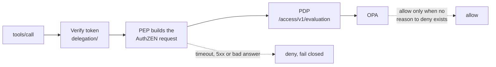

# Policy check before every tool call

The MCP server verifies the delegated token (`../delegation/`), then asks
whether this call is allowed before dispatching it. The code in the MCP server
that asks is the policy enforcement point (PEP). The service that answers is
the policy decision point (PDP), a small facade over OPA, the policy engine
that holds the rules. The request uses the OpenID AuthZEN evaluation shape of
subject, action, resource and context. The whole delegation chain is evaluated
once.



## What the policy enforces

The rules are in `rego/agent_tools.rego`.

- Every actor in the chain must be granted the tool, so access only narrows.
- The token must hold the tool's scope.
- Write-class tools need the user's approval for that exact call (tool plus arguments), single use, from a channel the model cannot write to.
- The resource must be in the session's resource list.
- The chain needs at least one actor and at most two; the token must be fresh.
- Unknown tools and unknown request channels are denied.
- Confirmation is on by default. A user can turn it off for ordinary writes; high-risk tools (merge) always need it.
- Voice requests also need a speaker match of 0.98 or better, origin on the home network, and a passed liveness check. These signals come from the speaker front end, never from the model.
- Any missing signal counts as a failed check.

## Run

This needs the OPA binary. On Windows, download `opa_windows_amd64.exe` from the OPA GitHub releases, rename it `opa.exe` and put it on PATH, or set `OPA_BIN`.

```
pip install -r ../delegation/requirements.txt
opa test rego -v        # 22 policy tests
python demo.py          # A and C end to end: prompt-injection scenario plus fail-closed cases
python -m pytest -q     # 16 tests, skipped if opa is missing
```

## Demo result

| Call | Result | Reason |
|---|---|---|
| Sub-agent reads PR 42, the real task | allowed |  |
| Injected sub-agent merge of PR 42 | denied | sub-agent not granted merge; token lacks `repo:write`; no approval |
| Injected gateway merge of PR 42 (the gateway holds `repo:write`) | denied | needs the user's approval for this exact call |
| Injected gateway read of acme/secrets | denied | outside this session |
| User approves that exact merge, gateway retries | allowed |  |
| Same approved merge replayed | denied | write-class tool needs the user's approval for this exact call; the approval was consumed |
| Approval for PR 42 used on PR 43 | denied | write-class tool needs the user's approval for this exact call |
| Token with no `act` chain | rejected before policy |  |
| Voice read, all checks pass | allowed |  |
| Voice request, match at 0.91 | denied | voice match below 0.98 |
| Voice request, replayed recording | denied | voice liveness check not passed |
| Voice request from off the home network | denied | voice request did not come from the home network |
| Voice request, front end sent no signals | denied | all three voice reasons |
| Voice merge with confirmations turned off | denied | high-risk tools always confirm |
| Voice comment with confirmations turned off | allowed |  |
| Policy engine down | denied | fail closed |
| PDP timeout | denied | fail closed |

## Future state

- The approval store is in memory and the approval channel is simulated. In the real gateway, approval has to come from a UI the model cannot drive.
- Session resources are set by the caller of the PEP. In the real gateway they come from the user's task, never from the model.
- Policy and data are loaded at OPA start. There is no bundle signing or versioned rollout.
- Liveness is an input here. The policy trusts the front end's result, and how good the liveness check is decides how much the voice path is worth.
- Tool output is not inspected. A read the policy allows can still return injected text. The defense is that the next call goes through the same check.
